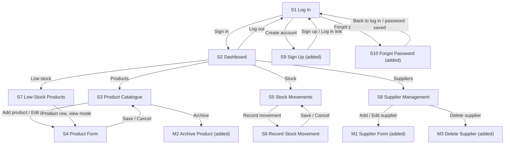

# IMPLEMENTATION_PLAN.md: ShelfWise

---

## 0. Plan details

| Field | Value |
| --- | --- |
| App name | ShelfWise |
| Built from PRD version | v0.1 (draft). To be re-issued as v1.0 once the decisions in PRD 13.3 are folded into the PRD body (Section 18 #1). Must match the version in docs/PRD.md |
| Screen designs | Google Stitch project: link pending (being generated by the Designer). Exported PNGs go in `docs/designs/`, one file per S# and M# (Section 18 #3) |
| Plan version | v0.2 |
| Repository | https://github.com/noluMolui/Shelfwise (Section 18 #2) |
| Status | Draft (waiting for the Stitch designs and for Section 18 to be Answered) |
| Last updated | 12 Nov 2026 |

---

## 1. Start here (instructions for the coding agent)

Before writing any code:

1. Read this whole file from top to bottom.
2. Read `docs/PRD.md`.
3. Look at the screen designs listed in Section 7.3.
4. Check Section 18. If any clarification is still **Open**, stop and ask the human. Do not start.
5. Check that the prerequisites in Section 4.2 are installed.
6. Start **Phase 1 only**. Follow Section 2 at all times.

---

## 2. Rules for the coding agent (copy word for word, do not edit)

1. **One phase at a time.** Only work on the phase the human asked for. When that phase's Definition of Done is complete, stop and wait for the human to say "Start Phase <number>".
2. **Test-driven development (TDD) for every task.** Follow the cycle in Section 12.1:
    - Write the test.
    - Run it and see it fail for the right reason.
    - Write the smallest code that makes it pass.
    - Run all tests.
    - Refactor while all tests still pass.
3. **Never cheat a test.** Never delete, skip, weaken or change a test just to make it pass. If you believe a test is wrong, stop and explain why to the human.
4. **Never break earlier work.** Every test from earlier phases must still pass before a phase is done.
5. **Build only what is planned.** Build only what is in this file and `docs/PRD.md`. Never build anything in Section 3.3 (Deferred).
6. **Ask, don't guess.** If anything is missing, unclear or contradictory, stop, add it to Section 18, and ask the human.
7. **Match the designs.** Every screen must match its design in Section 7.3: layout, order, labels, text, colours and spacing. Use the design tokens in Section 7.1. Never hard-code colours, font sizes or spacing.
8. **Every state, every screen.** Each screen must handle every state listed for it in Section 7.3 (chosen from normal, empty, loading, error, offline, success, plus any screen-specific states).
9. **Exact wording.** Use the exact labels and messages from the PRD. Never invent wording.
10. **Security first.**
    - Never put secret keys in app code, logs, test files or Git.
    - Every permission rule in Section 9 must be enforced on the server or database, never only in the app.
    - Every permission rule must have a test.
11. **Full check before "done".** Run the full check command (Section 4.3) before saying a phase is done, then add a short summary of the results to the Progress log (Section 17).
12. **Record your progress.** After each phase:
    - tick the checkboxes for that phase in this file;
    - add a row to the Progress log;
    - commit using the commit message given in the phase.
13. **No surprise libraries.** Do not add, remove or upgrade any library or tool not listed in Section 4.1 without asking the human first.
14. **Stuck rule.** If the same problem is still failing after 3 attempts, stop and report:
    - what you tried;
    - the exact error;
    - what you need from the human.
15. **Clean code.** Follow the folder structure in Section 5. Use the PRD's key terms (Section 3.4) for names in code. Keep files small and focused.

---

## 3. Project summary and scope

### 3.1 Summary

ShelfWise helps small businesses manage inventory so that they can track stock, suppliers and purchasing needs in one place. A business owner or staff member keeps a product catalogue, records incoming and outgoing stock, sees which products are at or below their low-stock threshold, keeps supplier records, and views a dashboard of total products, inventory value, low-stock products and recent stock activity.

**Platform:** Responsive web app that runs in a browser (desktop-first, with tablet and mobile browser layouts from 360px wide). No native apps.

### 3.2 Features in scope

| ID | Feature | Priority | Built in phase |
| --- | --- | --- | --- |
| F1 | Product Management | Must | 4 |
| F2 | Stock Management | Must | 5 |
| F3 | Low-Stock Alerts | Must | 6 |
| F5 | Business Dashboard | Must | 7 |
| F4 | Supplier Management | Should | 8 |

Accounts and sign-in (PRD Section 5) are not a numbered feature. They are built in Phase 3 because every feature needs them.

### 3.3 Deferred: do NOT build

- Payments and checkout (PRD non-goal 1)
- Accounting and tax filing (PRD non-goal 2)
- Automated supplier purchasing or placing orders with suppliers (PRD non-goal 3)
- Barcode scanning (PRD non-goal 4)
- CSV import and export, bulk migration (PRD non-goal 5)
- Native Android or iOS apps (PRD non-goal 6)
- Product images and any file or image storage (PRD 4.3, 11.1)
- Detailed inventory reports and other inventory analytics (PRD 4.3)
- Push, SMS or email notifications for low stock (PRD 4.5). Low stock shows inside the app only.
- Platform Admin screens (PRD 2.5). Platform administration is done in the Supabase dashboard.
- Supplier accounts or supplier log-ins (PRD 2.2; Section 18 #19). Suppliers are records only.
- A user belonging to more than one business (PRD 13.3 #5)
- More than one supplier per product (PRD 13.3 #9)
- Fractional stock quantities (PRD 13.3 #12)
- Editing or deleting a stock movement (PRD 13.3 #14)
- Hard-deleting a product (PRD 13.3 #15). Products are archived only.
- A screen to restore an archived product (PRD 10.3 leaves restore to be confirmed; see Section 18 #9)
- In-app staff invitation and staff role management (Section 18 #5)
- Self-service account deletion, change-email and change-password screens, a Profile/Settings screen and a Welcome screen (PRD 5, 8.1; see Section 18 #15)
- Dark mode (PRD 9.1)
- Offline writes or any queue of changes made offline (PRD 12.1)

### 3.4 Key terms (use these names in code)

| Term (PRD 1.7) | Name in code | Meaning |
| --- | --- | --- |
| Business | `Business`, table `businesses` | The small business whose inventory is managed. Every other record belongs to exactly one business (BR1). |
| Product | `Product`, table `products` | An item the business tracks. Has `sku`, `category`, `unit_price`, `quantity`, `low_stock_threshold`, `supplier_id`, `is_archived`. |
| SKU | `sku` | Business-defined stock-keeping code, unique within one business (BR2). |
| Stock movement | `StockMovement`, table `stock_movements` | One incoming or outgoing change to a product's quantity. Never edited or deleted (BR11). |
| Supplier | `Supplier`, table `suppliers` | A person or organisation that supplies products to the business. |
| Low-stock threshold | `low_stock_threshold` | Quantity at or below which a product is low-stock (BR8). Optional (BR9). |
| Inventory value | `inventory_value` | Sum of `unit_price * quantity` over the business's active (not archived) products (BR10). `unit_price` is the Selling Price in ZAR (PRD 13.3 #10, #11). |
| User profile | `UserProfile`, table `user_profiles` | A user's application profile: name, business and role. |
| Business Owner | role value `business_owner` | Full control of the business's products, suppliers, stock movements and dashboard. |
| Staff Member | role value `staff_member` | Reads products, suppliers and stock; records stock movements. |

---

## 4. Tech stack, prerequisites and commands

### 4.1 Stack

| Layer | Tool | Version | Used for |
| --- | --- | --- | --- |
| Frontend | React with Vite | Latest stable at setup (React 18 or newer) | Screens and build tooling |
| Routing | React Router (`react-router-dom`) | Latest stable at setup | Routes and guards (Section 11) |
| Language | TypeScript (strict mode) | 5 or newer | All app, test and script code |
| Styling | Tailwind CSS with `postcss` and `autoprefixer` | 3.4.x | Styling using design tokens |
| Fonts | `@fontsource/inter` | Latest | Inter 400, 600, 700 |
| Icons | `lucide-react` | Latest | Lucide outline icons |
| Backend client | `@supabase/supabase-js` | v2 | Talking to Supabase |
| Backend and database | Supabase: PostgreSQL, Auth. Supabase CLI as the dev dependency `supabase`, run with `npx` | Latest stable at setup | Data, log-in, Row-Level Security |
| Server functions | None in v1 | — | All rules live in RLS, constraints, triggers and SQL functions |
| Data fetching and caching | `@tanstack/react-query` | v5 | Loading states, retries, in-session cache for "previously loaded" data |
| Unit and component tests | Vitest + `@vitest/coverage-v8` + React Testing Library (`@testing-library/react`, `jest-dom`, `user-event`) + `jsdom` | Latest | Rules, components, screens, coverage |
| Database and permission tests | pgTAP via `supabase test db` | Supabase CLI | Tables, triggers, functions, RLS |
| Integration tests | Vitest + `supabase-js` against the local Supabase | Latest | Operations OP1–OP19 |
| End-to-end tests | Playwright (`@playwright/test`; Chromium for every run; Firefox and WebKit in Phase 9) | Latest | User flows in a real browser |
| Lint and type check | ESLint with `typescript-eslint` and `eslint-plugin-react-hooks`; TypeScript compiler (`tsc`) | Latest | Code quality |
| Secret scan | `secretlint` with `@secretlint/secretlint-rule-preset-recommend` | Latest | Finds keys accidentally committed (T-NFR-6) |
| CI | GitHub Actions | — | Runs the checks on pushes and pull requests |
| Build and hosting | Vercel, linked to the GitHub repository | — | Deploys on every push to `main` |
| Runtime | Node.js | 24 LTS or newer | Running tools; runs `.ts` scripts directly |

Record the exact installed versions in the Progress log (Section 17) after Phase 1.

### 4.2 Prerequisites on the computer

- [ ] Node.js 24 LTS or newer, and npm
- [ ] Git, with a GitHub account that has access to the repository
- [ ] Docker Desktop, running (the local Supabase needs it)
- [ ] Chrome (or Edge), plus Firefox and Safari access for the Phase 9 browser checks
- [ ] Playwright browser installed: `npx playwright install --with-deps chromium`
- [ ] Accounts: Supabase (hosted project in Phase 10) and Vercel (linked to GitHub)

### 4.3 Commands

| Purpose | Command |
| --- | --- |
| Install dependencies | `npm install` |
| Start the local backend | `npx supabase start` |
| Reset the database (migrations + seed data) | `npx supabase db reset` then `npm run seed:passwords` (= `node --env-file=.env scripts/set-seed-passwords.ts`). Both together: `npm run db:fresh` (= `npx supabase db reset && npm run seed:passwords`) |
| Start the app | `npm run dev` |
| Unit and component tests | `npm test` (= `vitest run`, config `vitest.config.ts`, folders `tests/unit` and `tests/components`) |
| Database and permission tests | `npx supabase test db` |
| Integration tests | `npm run test:integration` (= `node --env-file=.env node_modules/vitest/vitest.mjs run -c vitest.integration.config.ts`, environment `node`, folder `tests/integration`, files run one at a time) |
| End-to-end tests | `npm run test:e2e` (= `playwright test`; the config loads `.env`, runs one worker and starts `npm run dev` itself) |
| Lint | `npm run lint` (= `eslint .`) |
| Type check | `npm run typecheck` (= `tsc -b`) |
| Secret scan | `npx secretlint "**/*"` |
| **Full check (run before every "done")** | `npm run check` (runs lint, type check, `npm test`, `npx supabase test db` and `npm run test:integration`). `npx supabase start` must be running and the database must have been reset with passwords seeded (`npm run db:fresh`). |
| Build for release | `npm run build` (= `tsc -b && vite build`) |

End-to-end tests are run at the end of each feature phase and in Phase 9. They are not part of `npm run check`, because they need a running dev server and a browser. Each E2E spec file starts from a fresh database by calling `npm run db:fresh` in a `beforeAll` helper. Run one unit or component test with `npm test -- -t "T-US1-2"`.

---

## 5. Folder structure

```
shelfwise/
  src/
    main.tsx                         Entry point
    app/                             App shell: providers, router, route guards (Section 11)
    pages/                           One file per screen (S#)
      LoginPage.tsx                  S1 Log In
      DashboardPage.tsx              S2 Dashboard
      ProductCataloguePage.tsx       S3 Product Catalogue
      ProductFormPage.tsx            S4 Product Form (add, edit and view modes)
      StockMovementsPage.tsx         S5 Stock Movements
      RecordMovementPage.tsx         S6 Record Stock Movement
      LowStockPage.tsx               S7 Low-Stock Products
      SuppliersPage.tsx              S8 Supplier Management
      SignUpPage.tsx                 S9 Sign Up
      ForgotPasswordPage.tsx         S10 Forgot Password (request mode + set-new-password mode)
    components/
      common/                        Shared components (Section 7.2): Button, TextField, SelectField,
                                     Card, Toast, ConfirmModal, EmptyState, Skeleton, OfflineBanner,
                                     LoadMore, Header, MainNavigation
      dashboard/                     Dashboard-only pieces (summary cards, recent activity list)
      products/                      Product table/row, LowStockBadge, M2 Archive Product modal
      stock/                         Movement table/row, movement filters
      suppliers/                     Supplier table/row, M1 Supplier Form modal, M3 Delete Supplier modal
    hooks/                           Shared hooks (useOnlineStatus, useCurrentProfile)
    lib/
      supabase/client.ts             Supabase client (public key only)
      api/                           One file per operation group (Section 10)
      rules/                         Pure business-rule functions (BR#), no network
      messages.ts                    Every user-facing message from the PRD, in one place
    theme/tokens.ts                  Design tokens (Section 7.1)
    types/                           Shared TypeScript types (Business, Product, Supplier, StockMovement, UserProfile)
    utils/                           Formatting helpers (ZAR, dates in SAST)
  public/
    privacy.html                     Privacy Notice page (content supplied by the team, Section 18 #15)
  supabase/
    migrations/                      SQL migrations (Section 8.6)
    tests/database/                  pgTAP tests (T-SEC, T-BR, T-DB)
    seed.sql                         Seed rows (Section 8.7)
    config.toml                      Local Supabase settings (Auth settings in Phase 3)
  scripts/set-seed-passwords.ts      Sets every seed test account's password (uses the secret key; never in the app)
  tests/
    setup.ts                         Test setup (jest-dom, cleanup)
    unit/                            T-BR, T-AUTH, T-NFR unit tests
    components/                      T-C and screen-state tests
    integration/                     Operation tests against local Supabase
    integration/helpers/             testBusiness.ts: creates a fresh business, owner and staff for data-changing tests (Section 12.4)
    e2e/                             Playwright flows (T-E2E, T-NFR-9, T-NFR-12)
    e2e/helpers/                     resetDatabase.ts: runs npm run db:fresh before a spec file
  .github/workflows/ci.yml           GitHub Actions CI
  docs/PRD.md
  docs/designs/                      Exported designs: S1.png … S10.png, M1.png … M3.png (plus state frames)
  IMPLEMENTATION_PLAN.md
  index.html
  vite.config.ts
  vercel.json                        Rewrites every route to index.html (single-page app)
  vitest.config.ts
  vitest.integration.config.ts
  playwright.config.ts
  tailwind.config.ts
  postcss.config.js
  eslint.config.js
  tsconfig.json                      Plus tsconfig.app.json and tsconfig.node.json; the type check covers src and tests
  .secretlintrc.json
  .env.example
  .gitignore                         Lists .env and .env.hosted
  package.json
  README.md
```

Changes from the PRD 11.6 starting structure: `features/` is not used (feature code is grouped by folder under `components/` and `lib/api/`), `tests/` is split by level, and `theme/`, `public/privacy.html`, `scripts/`, `.github/` and `docs/designs/` are added.

**Rule:** a new folder may only be created if it is added to this section first.

---

## 6. Environment variables and secrets

| Name | What it is | Where to get it | Public or secret | Used by |
| --- | --- | --- | --- | --- |
| `VITE_SUPABASE_URL` | Supabase project URL | Local: `http://127.0.0.1:54321` (from `npx supabase status`). Hosted: Supabase dashboard → Project Settings → API | Public | App |
| `VITE_SUPABASE_ANON_KEY` | Supabase public (anon / publishable) client key | Same places | Public. Safe only because every table has RLS. | App |
| `VITE_APP_ENV` | Environment label: `development`, `test` or `production` | Team configuration | Public | App |
| `SUPABASE_URL` | Supabase address as scripts and tests see it | Local: `http://127.0.0.1:54321` | Public | Integration tests and scripts only |
| `SUPABASE_SERVICE_ROLE_KEY` | Admin (service role / secret) key | `npx supabase status` locally; hosted: Supabase dashboard | **Secret** | `scripts/set-seed-passwords.ts`, integration tests and `tests/integration/helpers` only. Never in the browser, never in Vercel's public variables. |
| `SEED_TEST_PASSWORD` | Password for all seed test accounts | You choose it | **Secret** | `scripts/set-seed-passwords.ts`, integration tests, Playwright |

`.env.example` (committed to Git, placeholder values only):

```
VITE_SUPABASE_URL=http://127.0.0.1:54321
VITE_SUPABASE_ANON_KEY=replace-with-anon-key
VITE_APP_ENV=development
SUPABASE_URL=http://127.0.0.1:54321
SUPABASE_SERVICE_ROLE_KEY=replace-with-service-role-key-never-commit
SEED_TEST_PASSWORD=replace-with-a-test-only-password
```

Rules:

- Real values go in `.env`, which is listed in `.gitignore` and never committed. Create it from the example on Windows with `copy .env.example .env` (Command Prompt) or `Copy-Item .env.example .env` (PowerShell), then replace the placeholder values.
- Hosted values for scripts and release tests go in `.env.hosted` (same names, hosted project values). It is also listed in `.gitignore` and never committed.
- Only variables starting with `VITE_` may be used in `src/`. A test (T-NFR-6) fails if `SERVICE_ROLE` appears anywhere in `src/`.
- Secret values are never used in app code. They are used only in scripts and integration tests, read from `.env`.
- Hosted values for the app are set as Vercel environment variables, never in Git.
- If a new variable is needed, add it here and to `.env.example` first.

---

## 7. Design system and screens

### 7.1 Design tokens (`src/theme/tokens.ts`, wired into `tailwind.config.ts`)

| Token | Value | From PRD |
| --- | --- | --- |
| `color.primary` | #17324D (Deep Navy) | 9.1 Primary colour |
| `color.accent` | #16A6A1 (Teal). Non-text use only: icons, focus ring, borders, active-nav marker (Section 18 #14) | 9.1 Secondary / accent |
| `color.background` | #F5F7FA | 9.1 |
| `color.surface` | #FFFFFF (cards, inputs, tables) | 9.1 (card surfaces; white is the only colour not listed, see Section 18 #14) |
| `color.text` | #17212B | 9.1 Main text colour |
| `color.onPrimary` | #FFFFFF (text on primary, error and success buttons) | 9.4 contrast |
| `color.error` / `color.success` / `color.warning` | #C62828 / #2E7D32 / #ED9B24. Warning is for icons and borders only, never text. | 9.1 |
| `font.family` | Inter (400, 600, 700) | 9.1 Font |
| `font.pageTitle` | 28px, weight 700 | 9.1 Text sizes |
| `font.sectionHeading` | 20px, weight 600 | 9.1 |
| `font.body` | 16px, weight 400 | 9.1, 9.4 |
| `font.small` | 12px, weight 400 | 9.1, 9.4 |
| `space.1` / `space.2` / `space.3` / `space.4` | 8 / 16 / 24 / 32 px | 9.1 Spacing unit 8px |
| `space.screenDesktop` / `space.screenMobile` | 24 / 16 px | 9.1 Screen side margin |
| `radius.card` / `radius.input` / `radius.button` | 12 / 8 / 8 px | 9.1 Corner radius |
| `shadow.soft` | Soft shadow, used only on raised cards and menus | 9.1 Shadows |
| `size.button` / `size.touchMin` | 44 / 44 px | 9.1, 9.4 |
| `layout.maxWidth` | 1200px (centred content on desktop) | 9.3 |
| `breakpoint.tablet` / `breakpoint.desktop` | 640 / 1024 px (mobile is under 640, tablet 640–1024, desktop over 1024) | 9.3 |
| `toast.durationMs` | 3000 | 8.3 Toast |

### 7.2 Shared components

| Component | File | Variants and states | Used on | Tests |
| --- | --- | --- | --- | --- |
| Button | `components/common/Button.tsx` | primary, secondary, danger; disabled while submitting; loading; visible keyboard focus; hover; min height 44 | All | T-C-1 |
| TextField | `components/common/TextField.tsx` | label, input, error text; normal, focused, disabled, error; password with show/hide | S1, S4, S6, S8 (M1), S9, S10 | T-C-2 |
| Card | `components/common/Card.tsx` | metric label and value; clickable only when it has a destination | S2 | T-C-3 |
| Toast | `components/common/Toast.tsx` | one short message; disappears after 3 seconds; important errors stay inline | S3–S8, M1 | T-C-4 |
| OfflineBanner | `components/common/OfflineBanner.tsx` | shown when offline; states whether displayed data is cached and whether changes were saved | All logged-in screens | T-C-5 |
| EmptyState | `components/common/EmptyState.tsx` | explanation text and optional next-action button | S2–S8 | T-C-6 |
| Skeleton | `components/common/Skeleton.tsx` | skeleton cards and rows | S2–S8 | T-C-7 |
| ConfirmModal | `components/common/ConfirmModal.tsx` | title, clear action and consequence, danger button, cancel; requires explicit confirmation; closes on Esc | M2, M3 | T-C-8 |
| Header | `components/common/Header.tsx` | ShelfWise name, page title, account menu (Log out, Privacy Notice); consistent height and spacing | S2–S8 | T-C-9 |
| MainNavigation | `components/common/MainNavigation.tsx` | Dashboard, Products, Stock, Low Stock, Suppliers; highlights current destination; side navigation on desktop, compact on tablet, collapsible on mobile | S2, S3, S5, S7, S8 | T-C-10 |
| SelectField | `components/common/SelectField.tsx` | label, options, placeholder, error text; same states as TextField | S4, S6, S3 (category filter), S5 (type filter) | T-C-11 |
| LowStockBadge | `components/products/LowStockBadge.tsx` | warning icon plus the text "Low stock"; never colour alone (9.4) | S3, S7 | T-C-12 |
| LoadMore | `components/common/LoadMore.tsx` | "Load more" button; loading; hidden when no more rows | S3, S5, S8 | T-C-13 |

### 7.3 Screens

Designs are pending (Section 18 #3). Until a design file exists for a screen, the agent builds only from the PRD 8.2 specification and asks the human; it never invents layout.

| ID | Screen | Route / file | Design | Who can open it (else redirect to) | Tab bar (main navigation) | Required states | Phase |
| --- | --- | --- | --- | --- | --- | --- | --- |
| S1 | Log In | `/login`, `pages/LoginPage.tsx` | `docs/designs/S1.png` | Logged out (else S2) | No | Normal, Loading, Error, Offline, Success | 1 (Normal only), 3 |
| S2 | Dashboard | `/`, `pages/DashboardPage.tsx` | `docs/designs/S2.png` | Logged in (else S1) | Yes | Normal, Empty, Loading, Error, Offline, Success | 3 (placeholder), 7 |
| S3 | Product Catalogue | `/products`, `pages/ProductCataloguePage.tsx` | `docs/designs/S3.png` | Logged in (else S1) | Yes | Normal, Empty, Loading, Error, Offline, Success | 3 (placeholder), 4, 6 (low-stock indicator) |
| S4 | Product Form | Add: `/products/new`. Edit: `/products/:id/edit`. View: `/products/:id`. All in `pages/ProductFormPage.tsx` | `docs/designs/S4.png` | Add and edit: Business Owner (else S3). View mode: any logged-in member of the business (else S1) | No | Normal, Invalid field, Duplicate SKU, Loading (saving), Error, Offline, Success | 4 |
| S5 | Stock Movements | `/stock`, `pages/StockMovementsPage.tsx` | `docs/designs/S5.png` | Logged in (else S1) | Yes | Normal, Empty, Loading, Error, Offline, Success | 3 (placeholder), 5 |
| S6 | Record Stock Movement | `/stock/new`, `pages/RecordMovementPage.tsx` | `docs/designs/S6.png` | Business Owner or Staff Member (else S1) | No | Normal, Insufficient stock, Invalid quantity, Loading (saving), Error, Offline, Success | 5 |
| S7 | Low-Stock Products | `/low-stock`, `pages/LowStockPage.tsx` | `docs/designs/S7.png` | Logged in (else S1) | Yes | Normal, Empty, Loading, Error, Offline | 3 (placeholder), 6 |
| S8 | Supplier Management | `/suppliers`, `pages/SuppliersPage.tsx` | `docs/designs/S8.png` | Logged in; Staff Member sees it read-only (else S1) | Yes | Normal, Empty, Loading, Error, Offline, Success | 3 (placeholder), 8 |
| S9 | Sign Up | `/signup`, `pages/SignUpPage.tsx` | `docs/designs/S9.png` | Logged out (else S2) | No | Normal, Loading, Error, Offline, Success (check-your-email message) | 3 |
| S10 | Forgot Password | `/forgot-password`, `pages/ForgotPasswordPage.tsx` | `docs/designs/S10.png`, `S10-set.png` | Logged out, or opened from the reset email link | No | Normal, Loading, Error, Offline, Success (both modes) | 3 |
| M1 | Supplier Form (modal) | opened from S8, `components/suppliers/SupplierFormModal.tsx` | `docs/designs/M1.png` | Business Owner | No | Normal, Invalid field, Loading (saving), Error, Offline, Success | 8 |
| M2 | Archive Product (modal) | opened from S3, `components/products/ArchiveProductModal.tsx` | `docs/designs/M2.png` | Business Owner | No | Normal, Loading (archiving), Error, Offline | 4 |
| M3 | Delete Supplier (modal) | opened from S8, `components/suppliers/DeleteSupplierModal.tsx` | `docs/designs/M3.png` | Business Owner | No | Normal, Loading (deleting), Error, Offline, Blocked (supplier in use) | 8 |

S9, S10 and M1–M3 are not in PRD 8.1 yet. They are proposed in Section 18 #4 and must be added to the PRD before their designs are made.

---

## 8. Data model and database

All tables live in the `public` schema. `user_profiles.id` is the same as the Supabase Auth user id. "Restrict" means the delete is refused while rows point to it. Roles are stored as `business_owner` and `staff_member`; movement types as `incoming` and `outgoing`.

### 8.1 Tables

**Table: `businesses`**: one business using ShelfWise.

| Column | Type | Null? | Default | Constraints | Notes |
| --- | --- | --- | --- | --- | --- |
| id | uuid | No | gen_random_uuid() | primary key | |
| name | text | No | — | check `length(btrim(name)) between 1 and 120` | |
| created_at | timestamptz | No | now() | | Store UTC, display SAST |

**Table: `user_profiles`**: one user's application profile and role.

| Column | Type | Null? | Default | Constraints | Notes |
| --- | --- | --- | --- | --- | --- |
| id | uuid | No | — | primary key; foreign key → `auth.users.id` on delete restrict | Created by trigger `handle_new_user` |
| business_id | uuid | No | — | foreign key → `businesses.id` on delete restrict | A user belongs to exactly one business (PRD 13.3 #5) |
| full_name | text | No | — | check `length(btrim(full_name)) between 1 and 120` | |
| role | text | No | — | check `role in ('business_owner','staff_member')` | Server-controlled (SEC5) |
| created_at | timestamptz | No | now() | | |

**Table: `suppliers`**: one supplier used by a business.

| Column | Type | Null? | Default | Constraints | Notes |
| --- | --- | --- | --- | --- | --- |
| id | uuid | No | gen_random_uuid() | primary key | |
| business_id | uuid | No | `public.current_business_id()` | foreign key → `businesses.id` on delete restrict; unique (id, business_id) | BR1 |
| name | text | No | — | check `length(btrim(name)) between 1 and 120` | |
| contact_person | text | Yes | — | check length ≤ 120 | |
| email | text | Yes | — | check basic email pattern when not null | |
| phone | text | Yes | — | check `phone ~ '^\+27[0-9]{9}$'` when not null | South African format (Section 18 #9) |
| created_at | timestamptz | No | now() | | |

**Table: `products`**: one product tracked by a business.

| Column | Type | Null? | Default | Constraints | Notes |
| --- | --- | --- | --- | --- | --- |
| id | uuid | No | gen_random_uuid() | primary key; unique (id, business_id) | |
| business_id | uuid | No | `public.current_business_id()` | foreign key → `businesses.id` on delete restrict | BR1 |
| name | text | No | — | check `length(btrim(name)) between 1 and 120` | |
| sku | text | No | — | check `sku = btrim(sku) and length(sku) between 1 and 60`; unique (business_id, sku) | BR2 |
| category | text | No | — | check `category in ('Stationery','Beverages','Electronics','Hardware','Consumables','General')` | Fixed list (PRD 13.3 #17) |
| description | text | Yes | — | check length ≤ 1000 | |
| unit_price | numeric(12,2) | No | — | check `unit_price >= 0` | Selling Price in ZAR (BR10) |
| quantity | integer | No | 0 | check `quantity >= 0` | Changed only by trigger `apply_stock_movement` (BR3) |
| low_stock_threshold | integer | Yes | — | check `low_stock_threshold >= 0` | BR8, BR9 |
| supplier_id | uuid | Yes | — | foreign key (supplier_id, business_id) → `suppliers (id, business_id)` on delete set null (supplier_id) | Same business only (SEC8) |
| is_archived | boolean | No | false | | BR12 |
| created_at | timestamptz | No | now() | | |
| updated_at | timestamptz | No | now() | | Updated by trigger on change |

**Table: `stock_movements`**: one incoming or outgoing stock change. Never edited or deleted.

| Column | Type | Null? | Default | Constraints | Notes |
| --- | --- | --- | --- | --- | --- |
| id | uuid | No | gen_random_uuid() | primary key | |
| business_id | uuid | No | `public.current_business_id()` | foreign key → `businesses.id` on delete restrict | |
| product_id | uuid | No | — | foreign key (product_id, business_id) → `products (id, business_id)` on delete restrict | Product must be in the same business; BR11, BR12 |
| user_id | uuid | No | `auth.uid()` | foreign key → `user_profiles.id` on delete restrict | Who recorded it (BR11) |
| movement_type | text | No | — | check `movement_type in ('incoming','outgoing')` | |
| quantity | integer | No | — | check `quantity > 0` | BR7 |
| note | text | Yes | — | check length ≤ 500 | |
| created_at | timestamptz | No | now() | | Store UTC, display SAST |

### 8.2 Relationships and delete behaviour

- One business has many user profiles, products, suppliers and stock movements. A business cannot be deleted while any of them exist (restrict).
- One product has many stock movements. A product with movements can never be deleted (restrict, BR12). Products are archived instead (`is_archived = true`).
- One supplier has many products. Deleting a supplier sets `products.supplier_id` to empty on any archived products; the delete is blocked while any active product is linked (trigger `block_supplier_delete`, PRD 13.3 #16).
- One user profile has many stock movements. A user profile cannot be deleted while it has movements (restrict), so the audit identity is kept (PRD 13.3 #24, Section 18 #15).
- A product's supplier must belong to the same business (composite foreign key), and a movement's product must belong to the movement's business (composite foreign key).

### 8.3 Status changes

| Table.column | From | To | Triggered by | Enforced by |
| --- | --- | --- | --- | --- |
| products.is_archived | false | true | Business Owner confirms M2 | RLS update policy (SEC9); `stock_movements` kept (BR12) |
| products.is_archived | true | false | Not available in the app in v1. Allowed for a Business Owner through the API only (Section 18 #9) | RLS update policy (SEC9) |
| stock_movements | not applicable | created | A valid stock movement is recorded | RLS insert policy (SEC15) + trigger `apply_stock_movement` |
| user_profiles.role | staff_member | business_owner | Platform admin in the Supabase dashboard only | No API permission to change `role` (SEC5) |

### 8.4 Indexes

- `products (business_id, name)`: catalogue list and search
- `products (business_id, is_archived)`: active product counts, dashboard, low-stock
- `products (supplier_id)`: linked product count per supplier, supplier delete guard
- `suppliers (business_id, name)`: supplier list and search
- `stock_movements (business_id, created_at desc, id desc)`: movement history and dashboard recent activity
- `stock_movements (product_id)`: product history checks
- `user_profiles (business_id)`: same-business reads

### 8.5 Automatic jobs and triggers

| Name | Runs when | What it does | BR# | Test |
| --- | --- | --- | --- | --- |
| `handle_new_user` | After insert on `auth.users` | If `raw_app_meta_data` holds `business_id` and `role` (set only by the platform admin, the seed or the test helper), creates a `user_profiles` row in that business. Otherwise, if `raw_user_meta_data` holds `business_name` and `full_name` (self sign-up), creates a new `businesses` row and a `business_owner` profile. It never reads `business_id` or `role` from `raw_user_meta_data`. | BR1 | T-DB-2, T-DB-3, T-DB-4 |
| `apply_stock_movement` | Before insert on `stock_movements` | Locks the product row, rejects an archived product (`product_archived`), rejects an outgoing quantity above the current quantity (`insufficient_stock`), then increases or decreases `products.quantity`. Runs in the same transaction as the insert, so a failed movement changes nothing. | BR4, BR5, BR6 | T-BR4-1, T-BR5-1, T-BR6-1, T-BR6-2, T-BR6-3 |
| `stock_movements_immutable` | Before update or delete on `stock_movements` | Raises `movement_immutable` for everyone, including the service role | BR11 | T-DB-5 |
| `set_products_updated_at` | Before update on `products` | Sets `updated_at = now()` | — | T-DB-6 |
| `block_supplier_delete` | Before delete on `suppliers` | Raises `supplier_in_use` if any active product is linked | — | T-DB-7 |

### 8.6 Migrations (in order)

Create each with the exact command shown, so it gets a timestamp prefix. Never edit an applied migration; add a new one.

1. `npx supabase migration new tables`: all tables, constraints and indexes in 8.1 and 8.4 (the `business_id` defaults that call `public.current_business_id()` are added in migration 2)
2. `npx supabase migration new helpers`: `public.current_business_id()` and `public.current_user_role()` (security definer, stable, `set search_path = ''`, read `user_profiles` for `auth.uid()`); `alter column business_id set default public.current_business_id()` on `suppliers`, `products`, `stock_movements`
3. `npx supabase migration new triggers`: all triggers in 8.5 and their functions
4. `npx supabase migration new rls`: RLS switched on for every table; all policies, column privileges and revokes in Section 9
5. `npx supabase migration new functions`: `get_dashboard_summary()` and `get_low_stock_products()` (security invoker, so RLS applies; see Section 10)

### 8.7 Seed data and test accounts

- **Seed file:** `supabase/seed.sql`. It loads the sample data set from PRD 8.4 for test business A, plus a second business and an empty business for isolation and empty-state tests. All seed rows are test data and use only test-only values. Supplier emails and phones are fake (for example `orders@mzansi-stationers.example` and `+27110000001`).
- **Test businesses (fixed ids):**
    - Business A "Thandi's Corner Shop (Test Data)" = `10000000-0000-0000-0000-000000000001`
    - Business B "Test Business B (Test Data)" = `10000000-0000-0000-0000-000000000002`
    - Business C "Empty Business (Test Data)" = `10000000-0000-0000-0000-000000000003`
- **Business A products:** ST001 A4 Exercise Book (Stationery, R25.00, threshold 10, Mzansi Stationers), ST002 Blue Ballpoint Pen (Stationery, R8.50, 10, Mzansi Stationers), DR001 2L Bottled Water (Beverages, R18.00, 8, FreshSupply Distributors), EL001 USB-C Cable (Electronics, R79.00, 5, TechSource Wholesale). Suppliers: the three in PRD 8.4.
- **Business A stock movements** (inserted through the normal trigger so quantities and history agree): opening incoming stock ST001 20, ST002 10, DR001 24, EL001 5, dated 30 days before the reset; then the three sample movements ST001 incoming 20, ST002 outgoing 4, EL001 outgoing 2, dated 2 days before the reset (ST001 at that time, ST002 one hour later, EL001 two hours later). The PRD shows these three as "10 Nov 2026"; dating them relative to the reset keeps the "last 7 days" dashboard figure stable (Section 18 #10). Resulting quantities: 40, 6, 24, 3 (as in PRD 8.4). Resulting dashboard values: 4 products, inventory value R1,720.00, 2 low-stock products (ST002 and EL001), 3 movements in the last 7 days. Seed rows set `business_id` and `user_id` explicitly, because their defaults need a logged-in user.
- **Business B:** two products (one with SKU ST001, to prove the same SKU is allowed in another business, BR2), one supplier, and one movement.
- **Business C:** an owner only, with no products.
- **Fixed seed user ids** (so database tests can act as each user):
    - owner.a = `20000000-0000-0000-0000-000000000001` (Business Owner, business A)
    - staff.a = `20000000-0000-0000-0000-000000000002` (Staff Member, business A)
    - owner.b = `20000000-0000-0000-0000-000000000003` (Business Owner, business B)
    - staff.b = `20000000-0000-0000-0000-000000000004` (Staff Member, business B)
    - owner.c = `20000000-0000-0000-0000-000000000005` (Business Owner, business C)
- **How the users are created:** `seed.sql` inserts the businesses first. For each user it then inserts one `auth.users` row (instance id `00000000-0000-0000-0000-000000000000`, audience and role `authenticated`, a placeholder password, a confirmed email, `raw_user_meta_data` holding `full_name`, `raw_app_meta_data` holding `business_id` and `role`, and every token column such as `confirmation_token` and `recovery_token` set to an empty string, not null) and one matching `auth.identities` row (provider `email`, with the user id and email in the identity data). Without the identity row and the empty token columns, signing in fails. Trigger `handle_new_user` then creates the profile.
- **Test accounts:** `owner.a@example.com`, `staff.a@example.com`, `owner.b@example.com`, `staff.b@example.com`, `owner.c@example.com`. The password comes from `SEED_TEST_PASSWORD`; `scripts/set-seed-passwords.ts` sets it on every seed user. Never write it in this file or in Git.
- **Freshness:** run `npm run db:fresh` before any test run that starts more than 5 days after the last reset, so the "last 7 days" figure stays correct.

---

## 9. Security and permissions

`public.current_business_id()` returns the caller's business. `public.current_user_role()` returns the caller's role. "Own business" means `business_id = public.current_business_id()`. Everything is enforced by RLS policies, column privileges, constraints and triggers; the app only hides controls.

| ID | Table / resource | Action | Who is allowed | Rule | Enforced by | Tests (allow / deny) |
| --- | --- | --- | --- | --- | --- | --- |
| SEC1 | businesses | read | Members of that business | `id = current_business_id()`; never another business | RLS select policy | T-SEC-1a / 1b |
| SEC2 | businesses | update | Business Owner | Own business only | RLS update policy using `current_user_role() = 'business_owner'` | T-SEC-2a / 2b |
| SEC3 | businesses | insert / delete | Nobody through the API | Created only by trigger `handle_new_user` | No insert or delete policy | T-SEC-3b |
| SEC4 | user_profiles | read | Members of the same business | Own business only; the table holds no email | RLS select policy | T-SEC-4a / 4b |
| SEC5 | user_profiles | update | The user, for their own row | Only `full_name`; cannot change `id`, `business_id` or `role` (no self-promotion; owners cannot change staff roles in v1) | RLS (`id = auth.uid()`) + column privileges `grant update (full_name)` | T-SEC-5a / 5b |
| SEC6 | user_profiles | insert / delete | Nobody through the API | Created only by trigger or admin | No insert or delete policy | T-SEC-6b |
| SEC7 | products | read | Members of the business | Own business only (BR1) | RLS select policy | T-SEC-7a / 7b |
| SEC8 | products | create | Business Owner | Own business; `supplier_id` must belong to the same business; `quantity` cannot be set | RLS with check + composite foreign key + column privileges (no insert on `quantity`) | T-SEC-8a / 8b |
| SEC9 | products | update | Business Owner | Own business; `quantity` can never be updated by an API caller (BR3); archive allowed | RLS update policy + column privileges (no update on `quantity`, `business_id`, `id`) | T-SEC-9a / 9b |
| SEC10 | products | delete | Nobody through the API | Products are archived, never deleted (BR12) | No delete policy; foreign key restrict | T-SEC-10b |
| SEC11 | suppliers | read | Members of the business | Own business only | RLS select policy | T-SEC-11a / 11b |
| SEC12 | suppliers | create / update | Business Owner | Own business only | RLS with check / using | T-SEC-12a / 12b |
| SEC13 | suppliers | delete | Business Owner | Own business; blocked while active products are linked | RLS delete policy + trigger `block_supplier_delete` | T-SEC-13a / 13b |
| SEC14 | stock_movements | read | Members of the business | Own business only | RLS select policy | T-SEC-14a / 14b |
| SEC15 | stock_movements | create | Business Owner and Staff Member | Own business; `user_id = auth.uid()`; product in the same business; quantity rules via trigger | RLS with check + composite foreign key + trigger `apply_stock_movement` | T-SEC-15a / 15b |
| SEC16 | stock_movements | update / delete | Nobody | Audit history is permanent (BR11) | No policy + trigger `stock_movements_immutable` | T-SEC-16b |
| SEC17 | get_dashboard_summary, get_low_stock_products | call | Logged-in members | Return only the caller's business (security invoker, so RLS applies); `anon` cannot call them | `revoke execute … from anon, public`; RLS | T-SEC-17a / 17b |
| SEC18 | All tables | any | `anon` (not logged in) | No access at all | `revoke all … from anon`; RLS | T-SEC-18b |

**Always-on security checks** (tested in Phase 9):

- [ ] Every table has permission rules switched on (RLS enabled). T-DB-9 lists every table in `public` and fails if any has RLS off.
- [ ] Input is checked in the app (`src/lib/rules`) **and** in the database (constraints in 8.1).
- [ ] Rate limits: the PRD gives no custom limits. v1 relies on Supabase Auth's built-in protections (`[auth.rate_limit]` left at defaults). Exact thresholds are in Section 18 #15.
- [ ] File uploads: none in v1 (no file or image storage).
- [ ] No passwords, tokens or personal data are written to logs (T-NFR-7).
- [ ] A secret scan (`npx secretlint "**/*"`) finds no keys (T-NFR-6).
- [ ] The deployed application is served over HTTPS (PRD 12.3; checked in Phase 10).
- [ ] Every restriction is also enforced in the database: a test calls the API directly as the wrong role and as the wrong business and is refused (the SEC tests).

---

## 10. Backend operations

All operations live in `src/lib/api/`. Each returns either data or one of the exact messages in `src/lib/messages.ts`. A database error is mapped to a message by one function (`mapError`): unique violation on `products (business_id, sku)` → duplicate SKU message; `insufficient_stock` → insufficient stock message; check violation on `quantity > 0` → invalid quantity message; row-level security violation → not-allowed message; foreign key violation when a product with movements is deleted → "This product has stock history and cannot be permanently deleted."; `supplier_in_use` → "This supplier is linked to products and cannot be deleted."; `product_archived` → "We couldn’t record this movement. Please try again."; network failure → offline message; anything else → "Something went wrong. Please try again."

| ID | Operation | Who can call it | Input | Output | Rules | Errors (exact message) | Built as | Tests |
| --- | --- | --- | --- | --- | --- | --- | --- | --- |
| OP1 | Sign up | Anyone logged out | full name, business name, email, password, age and privacy confirmations | Account created, verification email sent; business and owner profile created by trigger | PRD 5, BR1 | "We couldn’t create your account. Please try again." / "You’re offline. Check your connection and try again." | Supabase Auth `signUp` with `full_name` and `business_name` in user metadata | T-AUTH-2, T-INT-1, T-DB-2 |
| OP2 | Log in | Anyone logged out | email, password | Session | PRD 5 | "We couldn’t sign you in. Check your details and try again." / "Please verify your email before logging in." / "You’re offline. Check your connection and try again." | Auth `signInWithPassword` | T-AUTH-3, T-AUTH-4, T-AUTH-5, T-INT-2 |
| OP3 | Request password reset | Anyone | email | Always the same message | Never reveals whether an account exists | "If an account exists for this email, we’ve sent a reset link." | Auth `resetPasswordForEmail` with `redirectTo` set to the S10 URL | T-AUTH-6 |
| OP4 | Set new password | User opened from the reset link | new password | Password changed, user logged in | PRD 5 (6+ characters) | "Password must be at least 6 characters." | S10 reads the recovery session from the link, then Auth `updateUser` | T-AUTH-7 |
| OP5 | Log out | Logged in | — | Session ended, back to S1 | — | — | Auth `signOut` | T-AUTH-8, T-INT-2 |
| OP6 | Get current profile | Logged in | — | full name, role, business id and name | SEC1, SEC4 | "Something went wrong. Please try again." | Select from `user_profiles` joined to `businesses` | T-INT-3 |
| OP7 | List products | Logged in members | search text, category, and either page (20 rows) or `all` (id, name, SKU, quantity only; used by the S6 product selector) | active products with supplier name, ordered by name | BR1, SEC7 | "We couldn’t load your products. Please try again." | Table select with RLS; `is_archived = false`; search matches name or SKU (special characters escaped) | T-US1-1, T-S3-2, T-S6-4, T-INT-4 |
| OP8 | Get product | Logged in members | product id | one product with supplier | BR1, SEC7 | "You don’t have permission to access this information." | Table select with RLS | T-EDGE-6, T-INT-4 |
| OP9 | Create product | Business Owner | name, SKU, category, description, unit price, low-stock threshold, supplier | product saved with quantity 0 | BR2, BR3, SEC8 | "This SKU is already in use by your business." / "We couldn’t save this product. Please try again." | Table insert | T-US1-1, T-US1-3, T-US1-4, T-EDGE-1, T-SEC-8a/b |
| OP10 | Update product | Business Owner | product id and the editable fields (never quantity) | updated product | BR2, BR3, SEC9 | same as OP9 | Table update | T-US1-2, T-US1-4, T-BR3-1, T-SEC-9a/b |
| OP11 | Archive product | Business Owner | product id | `is_archived = true`; movements kept | BR12, SEC9 | "We couldn’t save this product. Please try again." / "This product has stock history and cannot be permanently deleted." (shown if a hard delete is attempted through the API) | Table update of `is_archived` | T-M2-1, T-BR12-1, T-BR12-2, T-EDGE-7 |
| OP12 | Record stock movement | Business Owner, Staff Member | product id, movement type, quantity, optional note | movement saved and product quantity updated in one transaction | BR4–BR7, BR11, SEC15 | "There is not enough stock for this movement." / "Enter a quantity greater than zero." / "We couldn’t record this movement. Please try again." / "You’re offline. Your changes have not been saved." | Table insert on `stock_movements`; trigger `apply_stock_movement` updates the product | T-US2-1, T-US2-2, T-US2-3, T-US2-4, T-BR6-3, T-BR7-3, T-INT-5, T-EDGE-2, T-EDGE-3 |
| OP13 | List stock movements | Logged in members | type filter, from date, to date (South African calendar days, converted to UTC start and end of day), page (20 rows) or limit (dashboard uses 5) | movements newest first with product name, SKU and recorder's full name | BR1, BR11, SEC14 | "We couldn’t load stock activity. Please try again." | Table select with RLS joined to `products` and `user_profiles` | T-S5-1, T-S5-2, T-INT-6 |
| OP14 | Get low-stock products | Logged in members | — | active products with `low_stock_threshold` not null and `quantity <= low_stock_threshold` | BR8, BR9, SEC17 | "We couldn’t load low-stock products. Please try again." | Database function `get_low_stock_products()` (security invoker) | T-US3-1, T-US3-2, T-BR8-2, T-BR9-1, T-INT-7 |
| OP15 | List suppliers | Logged in members | search text, and either page (20 rows) or `all` (id and name only; used by the S4 supplier dropdown) | suppliers with linked product count | BR1, SEC11 | "We couldn’t load suppliers. Please try again." | Table select with RLS plus count of active linked products | T-S8-1, T-INT-8 |
| OP16 | Create supplier | Business Owner | name, contact person, email, phone | supplier saved | SEC12 | "We couldn’t save this supplier. Please try again." | Table insert | T-US4-1, T-M1-1, T-INT-8 |
| OP17 | Update supplier | Business Owner | supplier id and fields | updated supplier | SEC12 | same as OP16 | Table update | T-INT-8 |
| OP18 | Delete supplier | Business Owner | supplier id | supplier removed | SEC13 | "This supplier is linked to products and cannot be deleted." (Section 18 #11) | Table delete; trigger `block_supplier_delete` | T-EDGE-8, T-DB-7, T-SEC-13a/b |
| OP19 | Get dashboard summary | Logged in members | — | total products, inventory value, low-stock count, number of movements in the last 7 days | BR8–BR10, SEC17 | "We couldn’t load your dashboard. Please try again." | Database function `get_dashboard_summary()` (security invoker) | T-US5-1, T-BR10-1, T-BR10-2, T-INT-9 |

Linking a supplier to a product (US4) is done by choosing a supplier on S4, using OP9 and OP10 (Section 18 #4). Rejecting a supplier from another business is covered by T-US4-3.

---

## 11. Navigation rules

- **Logged out:** can only open S1, S9 and S10. Any other route → S1.
- **Logged in:** opening S1 or S9 → S2. S10 is allowed only when opened from a password-reset email link; the recovery session keeps the user on S10 until the new password is saved.
- **Session expired:** show "Your session has expired. Please log in again." and go to S1.
- **Roles:** a Staff Member opening `/products/new` or `/products/:id/edit` → S3. `/products/:id` shows view mode (no Save, no supplier change) for every member. Staff see S8 read-only (no Add, Edit or Delete supplier). Controls a role cannot use are hidden, and the database refuses them anyway.
- **Another business's record:** opening a product id the caller cannot read shows "You don’t have permission to access this information." and goes to S3. Nothing from the other business is shown.
- **Main navigation:** Dashboard (S2), Products (S3), Stock (S5), Low Stock (S7), Suppliers (S8). Shown on S2, S3, S5, S7 and S8; not on S1, S4, S6, S9, S10 (PRD 8.1, Section 18 #4). The current destination is highlighted. On desktop (over 1024px) it is a side navigation; on tablet (640–1024px) a compact side or top navigation; on mobile (under 640px) a collapsible navigation.
- **Account menu (Header):** "Log out" → S1; "Privacy Notice" opens `/privacy.html` in a new tab.
- **Entry points:** S2 cards → total products S3, low-stock S7, recent activity S5. S3 "Add product" → `/products/new`; S3 "Edit" (and a product row, for a Business Owner) → `/products/:id/edit`; a product row for a Staff Member → `/products/:id`. S5 "Record movement" → S6. S7 product row → `/products/:id` in view mode (PRD 7.1 Flow 3 destination, Section 18 #4). S8 "Add supplier" or a supplier row → M1.
- **Back:** the browser Back button goes to the previous screen. Modals (M1–M3) close on Cancel or Esc. Save or Cancel on S4 and S6 returns to S3 and S5 respectively.
- **Navigation map:** copied from PRD 7.2, with the additions for S9, S10, M1–M3 and S7 → S4 marked below.



---

## 12. Testing strategy

### 12.1 The TDD cycle (every task, every phase)

1. **Red:** write one test for the behaviour, using the acceptance criterion or rule. Run it. It must **fail**, and fail for the expected reason (e.g. "screen not found", not "syntax error").
2. **Green:** write the **smallest** amount of code that makes that test pass. Run **all** tests.
3. **Refactor:** clean up names, remove duplication, move code to the right folder. Run all tests again. They must still pass.
4. Repeat for the next test.

### 12.2 Test levels

| Level | What it proves | Tool | Folder | Command |
| --- | --- | --- | --- | --- |
| Unit | Business rules and helper functions give the right answers | Vitest | `tests/unit/` | `npm test` |
| Component | Each component and screen shows the right things in every state, with fake data (`src/lib/api` mocked) | Vitest + React Testing Library | `tests/components/` | `npm test` |
| Database and permissions | Constraints, triggers, functions and permission rules allow and deny the right people | pgTAP | `supabase/tests/database/` | `npx supabase test db` |
| Integration | Each backend operation (OP1–OP19) works against the real local backend | Vitest + supabase-js | `tests/integration/` | `npm run test:integration` |
| End-to-end | Whole user flows work in a real browser against the local backend | Playwright | `tests/e2e/` | `npm run test:e2e` |
| Manual | Screens match the designs; real-device and browser checks | Human | Checklists in each phase | — |

### 12.3 Test IDs

Every automated test name starts with its ID, so a single test can be found and run on its own, for example `it('T-US1-3 shows the duplicate SKU message', …)`. Run one test with `npm test -- -t "T-US1-3"`.

| Prefix | Comes from | Example |
| --- | --- | --- |
| T-SETUP-# | Phase 1 tool and setup checks | T-SETUP-1 |
| T-US#-# | PRD acceptance criteria (Section 6) | T-US1-2 |
| T-AUTH-# | Account rules (PRD Section 5) | T-AUTH-1 |
| T-BR#-# | Business rules (PRD 4.4) | T-BR1-1 |
| T-SEC-#a / b | Permission rules (Section 9), allow / deny | T-SEC-3b |
| T-DB-# | Database constraints and triggers not covered by a BR | T-DB-2 |
| T-INT-# | Backend operations not covered by a T-US test (Section 10) | T-INT-1 |
| T-C-# | Shared components (Section 7.2) | T-C-4 |
| T-S#-# / T-M#-# | Extra states or behaviour of one screen or modal | T-S6-1 |
| T-NAV-# | Navigation rules (Section 11) | T-NAV-1 |
| T-EDGE-# | Edge cases (PRD 6.2) | T-EDGE-2 |
| T-E2E-# | User flows (PRD 7.1) | T-E2E-1 |
| T-NFR-# | Quality requirements (PRD 12.1) | T-NFR-3 |
| T-REL-# | Release checks (release phase) | T-REL-1 |

The same ID may be used at two levels when both prove the same criterion, e.g. T-US1-1 as a component test and as an integration test.

PRD edge cases (6.2) map to IDs as: T-EDGE-1 duplicate SKU, T-EDGE-2 outgoing exceeds stock, T-EDGE-3 zero or negative quantity, T-EDGE-4 offline while saving, T-EDGE-5 dashboard request fails, T-EDGE-6 another business's record, T-EDGE-7 product with stock history, T-EDGE-8 supplier deleted while linked.

### 12.4 Test data rules

- Tests never depend on each other or on the order they run in.
- pgTAP tests run inside a transaction and roll back; each starts from the seed data. To act as a seed user, run `set local role authenticated;` and then `select set_config('request.jwt.claims', json_build_object('sub', '20000000-0000-0000-0000-000000000001', 'role', 'authenticated')::text, true);`, using the fixed id of the user needed (Section 8.7; the example is owner.a).
- Integration tests that only read sign in as the seed users (`SEED_TEST_PASSWORD`) and read businesses A, B and C. Integration tests that change data never touch businesses A, B or C. They call `tests/integration/helpers/testBusiness.ts`, which uses the service role to create a new business with an owner and a staff member (random `@example.com` emails, confirmed, `app_metadata` holding `business_id` and `role`, password `SEED_TEST_PASSWORD`) and returns signed-in clients. Stock movements are permanent (BR11) and products with movements cannot be deleted (BR12), so these tests do not delete what they create; random names prevent clashes and `npm run db:fresh` clears everything. Sign-up tests also leave their random users in place.
- Each E2E spec file starts with `tests/e2e/helpers/resetDatabase.ts`, which runs `npm run db:fresh`, so every flow starts from the seed data. E2E specs run one at a time.
- Component tests use fake data from the PRD sample data set (8.4): the four products, three suppliers and three movements. They never make real network calls.
- Tests never use real personal data or real passwords.

### 12.5 Coverage rules

- 100% of PRD acceptance criteria (T-US…) have an automated test, or a manual check where automation is not possible (marked "manual").
- 100% of business rules BR1–BR12 have unit or database tests.
- 100% of permission rules SEC1–SEC18 have an allow test and a deny test (SEC3, SEC6, SEC10, SEC16 and SEC18 have deny only).
- 100% of PRD edge cases (T-EDGE-1 to T-EDGE-8) have a test.
- At least 90% line coverage for `src/lib/rules/`.

---

## 13. Phases

### 13.0 Phase overview

| Phase | Name | Features | Screens | Main tests |
| --- | --- | --- | --- | --- |
| 1 | Foundation | — | S1 (Normal state) | T-SETUP-1–5, T-C-1–8, T-S1-1 |
| 2 | Data and security | — | — | T-SEC-1a–18b, T-DB-1–8, T-DB-10, T-BR1–BR12 (database parts) |
| 3 | Accounts and app shell | PRD Section 5 | S1, S9, S10, placeholders for S2–S8 | T-AUTH-1–10, T-NAV-1–3, T-C-9–10, T-INT-1–3 |
| 4 | Product management | F1 | S3, S4, M2 | T-US1, T-S3-1–4, T-S4-1–4, T-M2-1, T-C-11, T-C-13, T-EDGE-1, 6, 7 |
| 5 | Stock management | F2 | S5, S6 | T-US2, T-S5, T-S6, T-BR6-3, T-BR7, T-EDGE-2, 3 |
| 6 | Low-stock alerts | F3 | S7, S3 (indicator) | T-US3, T-BR8, T-BR9, T-C-12, T-S3-5, T-S7 |
| 7 | Business dashboard | F5 | S2 | T-US5, T-BR10, T-S2, T-EDGE-5 |
| 8 | Supplier management | F4 | S8, M1, M3 | T-US4, T-S8, T-M1-1, T-M3-1, T-EDGE-8 |
| 9 | Hardening | — | All | T-EDGE-4, T-NFR-1–12, T-DB-9, T-E2E-1–5 |
| 10 | Release | — | All | T-REL-1–3, full suite |

---

### Phase 1: Foundation

**Goal:** The app opens on S1 Log In showing its Normal state, matching its design, and every test level has one passing example test.

**Covers:** Screens S1 (Normal state only) · Components Button, TextField, Card, Toast, OfflineBanner, EmptyState, Skeleton, ConfirmModal

**Starts when:** All of Section 18 is Answered, the designs for S1 exist in `docs/designs/`, and the human says "Start Phase 1".

**Step 1: Write the failing tests first (Red)**

| Test ID | Level | File | What it checks |
| --- | --- | --- | --- |
| T-SETUP-1 | Unit | `tests/unit/tokens.test.ts` | Tokens match Section 7.1 exactly (e.g. `color.primary` is #17324D, `color.accent` is #16A6A1, `color.background` is #F5F7FA) |
| T-SETUP-5 | Unit | `tests/unit/messages.test.ts` | `messages.ts` holds every message in PRD 12.2 with the exact text (e.g. "There is not enough stock for this movement.") |
| T-C-1 | Component | `tests/components/Button.test.tsx` | Primary, secondary and danger render; disabled cannot be pressed; loading blocks presses; minimum height 44; focus ring visible on keyboard focus |
| T-C-2 | Component | `TextField.test.tsx` | Shows label and error text when `error` is set; password field show/hide toggle works; error is linked to the input for screen readers |
| T-C-3 | Component | `Card.test.tsx` | Shows label and value; is clickable only when given a destination |
| T-C-4 | Component | `Toast.test.tsx` | Shows the text and disappears after 3 seconds |
| T-C-5 | Component | `OfflineBanner.test.tsx` | Visible with the given text when offline; hidden when online |
| T-C-6 | Component | `EmptyState.test.tsx` | Shows text and an optional button that calls its action |
| T-C-7 | Component | `Skeleton.test.tsx` | Renders card and row placeholders |
| T-C-8 | Component | `ConfirmModal.test.tsx` | Danger button calls confirm; Cancel and Esc call cancel; nothing happens without a click |
| T-S1-1 | Component | `tests/components/LoginPage.test.tsx` | S1 shows the ShelfWise name, email field, password field with show/hide, "Log in", "Forgot password?" and "Create account" (PRD 8.2 S1) |
| T-SETUP-2 | Database | `supabase/tests/database/000_setup.test.sql` | pgTAP runs: `select has_schema('public')` passes |
| T-SETUP-3 | Integration | `tests/integration/health.test.ts` | The app's Supabase client connects to the local backend |
| T-SETUP-4 | E2E | `tests/e2e/00-launch.spec.ts` | The app opens in Chromium and S1 shows "Log in" |

- [ ] All tests above are written, run, and fail for the expected reason.

**Step 2: Backend (Green)**

- [ ] `npx supabase init`; `npx supabase start` works; pgTAP tests run with `npx supabase test db`.
- [ ] `src/lib/supabase/client.ts` creates the client from the `VITE_` variables only.

**Step 3: Frontend (Green)**

- [ ] Create the Vite React TypeScript app in the repository root. Add every library in Section 4.1. Set the dev server to port 5173 with `strictPort`.
- [ ] `src/theme/tokens.ts` with every token in 7.1, wired into `tailwind.config.ts`. Load Inter (400, 600, 700) with `@fontsource/inter`.
- [ ] Build the 8 components in 7.2 for this phase (T-C-1 to T-C-8) and `src/lib/messages.ts`.
- [ ] Build S1 Log In (Normal state, no sign-in behaviour yet) to `docs/designs/S1.png`.
- [ ] Add `.env.example`, `.gitignore` (includes `.env` and `.env.hosted`), `vercel.json`, the `check`, `test`, `test:integration`, `test:e2e`, `lint`, `typecheck`, `seed:passwords` and `db:fresh` scripts, `vitest.config.ts`, `vitest.integration.config.ts`, `playwright.config.ts` (loads `.env` with `process.loadEnvFile`, one worker), the config files listed in Section 5, and a README with setup steps.
- [ ] `.github/workflows/ci.yml` runs on every push and pull request: install, lint, type check, `npm test`, secret scan. (The database and integration steps are added in Phase 2.)

**Step 4: Refactor and full check**

- [ ] Code cleaned up; names use PRD key terms.
- [ ] `npm run check` passes. `npm run test:e2e -- 00-launch` passes (T-SETUP-4).

**Step 5: Manual checks (human)**

- [ ] S1 in the browser matches S1.png side by side: layout, text, colours, spacing.
- [ ] `.env` is not shown by `git status`.
- [ ] `main` is protected on GitHub and this phase went in through a reviewed pull request.

**Definition of Done**

- [ ] Every test in Step 1 passes.
- [ ] S1 shows its Normal state.
- [ ] Exact installed versions are recorded in the Progress log.
- [ ] Manual checks ticked by the human.
- [ ] Progress log updated (Section 17).

**Commit message:** `Phase 1: Foundation`

**STOP.** Wait for the human to say "Start Phase 2".

---

### Phase 2: Data and security

**Goal:** The whole database exists with every rule, trigger and permission enforced and tested, and the seed data loads with two commands.

**Covers:** Section 8 (all) · Section 9 SEC1–SEC18 · Rules BR1–BR12 (database parts) · Operations OP14 and OP19 (database functions)

**Starts when:** Phase 1 is complete and the human says "Start Phase 2".

**Step 1: Write the failing tests first (Red)**

All tests in this phase are pgTAP tests in `supabase/tests/database/`.

| Test ID | File | What it checks |
| --- | --- | --- |
| T-DB-1 | `010_tables.test.sql` | Every table and column in 8.1 exists with the right type, null rule, default and check constraints |
| T-DB-2 | `020_signup.test.sql` | Creating an `auth.users` row with `business_name` and `full_name` in `raw_user_meta_data` creates one business and one `business_owner` profile |
| T-DB-3 | same | `business_id` or `role` supplied in `raw_user_meta_data` is ignored: the user gets their own new business, never another business |
| T-DB-4 | same | `business_id` and `role` in `raw_app_meta_data` create a profile in that business with that role (staff creation path) |
| T-DB-5 | `030_rules.test.sql` | Updating or deleting a `stock_movements` row raises `movement_immutable`, also for the service role |
| T-DB-6 | same | Updating a product changes `updated_at` |
| T-DB-7 | same | Deleting a supplier with an active linked product raises `supplier_in_use`; with only archived linked products it succeeds and clears their `supplier_id`; with none it succeeds |
| T-DB-8 | same | Constraints reject: category outside the fixed list, negative threshold, negative price, SKU with leading space or empty, name over 120 characters, bad email, phone not matching `+27` plus 9 digits |
| T-DB-10 | `090_seed.test.sql` | After a reset: 3 businesses; 5 users, each with a profile of the right business and role; business A has 4 products with quantities 40, 6, 24 and 3, 3 suppliers and 7 movements |
| T-BR1-1 | `040_isolation.test.sql` | As owner.a, products, suppliers, movements and profiles of business B are not visible |
| T-BR1-2 | same | As owner.a, inserting a product or supplier with business B's `business_id` fails |
| T-BR2-1 | `030_rules.test.sql` | A second product with the same SKU in one business is rejected |
| T-BR2-2 | same | The same SKU in two different businesses is accepted (ST001 exists in A and B) |
| T-BR3-1 | `050_stock.test.sql` | As owner.a, directly updating `products.quantity` is denied |
| T-BR3-2 | same | As owner.a, inserting a product with a `quantity` value is denied; a new product starts at 0 |
| T-BR4-1 | same | An incoming movement of 20 on a product with 10 gives quantity 30 |
| T-BR5-1 | same | An outgoing movement of 4 on a product with 10 gives quantity 6 |
| T-BR6-1 | same | An outgoing movement of 5 on a product with 4 raises `insufficient_stock`; quantity stays 4 and no movement row is saved |
| T-BR6-2 | same | An outgoing movement of exactly the available quantity succeeds and leaves 0 |
| T-BR7-2 | same | Movement quantities 0 and -1 are rejected |
| T-BR8-2 | `060_functions.test.sql` | `get_low_stock_products()` returns quantity 5 / threshold 5 and quantity 4 / threshold 5; does not return quantity 6 / threshold 5 |
| T-BR9-1 | same | A product with no threshold is never returned |
| T-BR10-1 | same | `get_dashboard_summary()` for business A returns 4 products, inventory value 1720.00, 2 low-stock products and 3 movements in the last 7 days |
| T-BR10-2 | same | An archived product is excluded from total products, inventory value and low-stock count |
| T-BR11-1 | `050_stock.test.sql` | A saved movement keeps its type, quantity, product, `created_at` and `user_id` equal to the caller |
| T-BR12-1 | same | Deleting a product that has movements is refused |
| T-BR12-2 | same | Archiving a product keeps all its movements |
| T-SEC-1a … T-SEC-18b | `070_rls.test.sql` | One allow and one deny test per row in Section 9, acting as owner.a, staff.a, owner.b and as `anon` (SEC3, SEC6, SEC10, SEC16, SEC18 deny only) |

- [ ] All tests above are written, run, and fail for the expected reason.

**Step 2: Backend (Green)**

- [ ] Migrations 1 to 5 exactly as in Section 8.6, applied with `npx supabase db reset`.
- [ ] `supabase/seed.sql` loads the seed data in 8.7 (including the `auth.identities` rows, empty-string token columns, explicit `business_id` and `user_id`, and relative movement dates). `scripts/set-seed-passwords.ts` sets every seed user's password to `SEED_TEST_PASSWORD` (`npm run seed:passwords`).
- [ ] The CI workflow gains the database steps: `npx supabase start`, `npm run db:fresh` (with `.env` built from `npx supabase status -o env`, and `SEED_TEST_PASSWORD` from a GitHub Actions secret), `npx supabase test db`, `npm run test:integration`.

**Step 3: Frontend (Green)**

- [ ] None in this phase.

**Step 4: Refactor and full check**

- [ ] Every function has `set search_path = ''`. These are `security definer` because they must work past RLS: `current_business_id`, `current_user_role`, `handle_new_user`, `apply_stock_movement`, `block_supplier_delete`. `get_dashboard_summary` and `get_low_stock_products` are security invoker, so RLS applies.
- [ ] `npm run check` passes (includes all Phase 1 tests).

**Step 5: Manual checks (human)**

- [ ] In local Supabase Studio, the three businesses, five seed users, four products and seven movements are visible, and quantities are 40, 6, 24, 3.
- [ ] RLS shows "enabled" on every table.

**Definition of Done**

- [ ] Every test in Step 1 passes; all Phase 1 tests still pass.
- [ ] Reset + seed works from scratch with `npm run db:fresh`.
- [ ] Manual checks ticked by the human.
- [ ] Progress log updated.

**Commit message:** `Phase 2: Data and security`

**STOP.** Wait for the human to say "Start Phase 3".

---

### Phase 3: Accounts and app shell

**Goal:** A business owner can sign up, verify their email, log in, reset a forgotten password and log out; the signed-in app shell, navigation and role redirects work; every other screen exists as a titled placeholder.

**Covers:** PRD Section 5 and 2.4 · Screens S1, S9, S10, placeholders for S2–S8 · Components Header, MainNavigation · Operations OP1–OP6 · Permissions SEC1, SEC4

**Starts when:** Phase 2 is complete, the designs for S1, S9 and S10 exist, and the human says "Start Phase 3".

**Step 1: Write the failing tests first (Red)**

| Test ID | Level | File | What it checks |
| --- | --- | --- | --- |
| T-AUTH-1 | Unit | `tests/unit/password.test.ts` | "abcdef" (6 characters) passes; "abcde" (5) fails |
| T-AUTH-2 | Component + Integration | `SignUpPage.test.tsx`, `auth.int.test.ts` | Valid form with both boxes ticked → account created → "Check your email and click the link to verify your account."; a business and an owner profile exist afterwards |
| T-AUTH-3 | Component + Integration | `LoginPage.test.tsx`, `auth.int.test.ts` | A verified user logs in → S2 |
| T-AUTH-4 | Component | `LoginPage.test.tsx` | Wrong details → "We couldn’t sign you in. Check your details and try again."; offline → "You’re offline. Check your connection and try again."; the button is disabled with a spinner while submitting |
| T-AUTH-5 | Component + Integration | same | An unverified user cannot log in and sees "Please verify your email before logging in." |
| T-AUTH-6 | Component + Integration | `ForgotPasswordPage.test.tsx` | Any email → "If an account exists for this email, we’ve sent a reset link." (identical for unknown emails) |
| T-AUTH-7 | Component + Integration | same | Opened from the reset link → set-new-password mode; a valid new password logs the user in → S2; a 5-character password shows "Password must be at least 6 characters." |
| T-AUTH-8 | Component + Integration | `Header.test.tsx`, `auth.int.test.ts` | "Log out" ends the session and goes to S1 |
| T-AUTH-9 | Component | `session.test.tsx` | An expired session shows "Your session has expired. Please log in again." and goes to S1 |
| T-AUTH-10 | Component | `SignUpPage.test.tsx` | "Create account" is disabled until both the age (18 or older) and Privacy Notice boxes are ticked; the Privacy Notice link opens `/privacy.html`; missing fields show "This field is required." |
| T-NAV-1 | Component | `navigation.test.tsx` | Logged out: any route except S1, S9, S10 → S1 |
| T-NAV-2 | Component | same | Logged in: S1 and S9 → S2; S10 opens only in password-recovery mode |
| T-NAV-3 | Component | same | Staff Member opening `/products/new` or `/products/:id/edit` → S3; Business Owner opens both |
| T-C-9 | Component | `Header.test.tsx` | Shows the ShelfWise name, page title and account menu with "Log out" and "Privacy Notice" |
| T-C-10 | Component | `MainNavigation.test.tsx` | Five destinations in order; current one highlighted; each opens its route; collapsible toggle works in compact mode |
| T-INT-1 | Integration | `auth.int.test.ts` | OP1 creates the auth user, business and `business_owner` profile; user metadata `business_id` cannot join another business |
| T-INT-2 | Integration | same | OP2 and OP5 give and end a session; a protected query after log out is refused |
| T-INT-3 | Integration | `profile.int.test.ts` | OP6 returns the caller's full name, role and business name, and nothing from another business |

- [ ] All tests above are written, run, and fail for the expected reason.

**Step 2: Backend (Green)**

- [ ] Supabase Auth settings in `supabase/config.toml`:
    - `[auth] minimum_password_length = 6` (PRD 13.3 #19);
    - `[auth.email] enable_confirmations = true`;
    - `[auth] site_url = "http://127.0.0.1:5173"` and `additional_redirect_urls` includes `http://127.0.0.1:5173/forgot-password` and `http://localhost:5173/forgot-password`;
    - `[auth.rate_limit]` left at its defaults.

**Step 3: Frontend (Green)**

- [ ] `src/lib/rules/password.ts`; `src/lib/api/auth.ts` (OP1–OP5) and `profile.ts` (OP6), with messages from `src/lib/messages.ts`.
- [ ] `src/app/`: providers (router, TanStack Query, session), route guards and redirects (Section 11), including the password-recovery exception and the session-expired message.
- [ ] Header (T-C-9), MainNavigation (T-C-10) and the signed-in layout with the OfflineBanner. `useOnlineStatus` hook.
- [ ] S1 Log In made functional; S9 Sign Up (full name, business name, email, password, age box, privacy box); S10 Forgot Password (request mode and set-new-password mode). Build each to its design with every state in 7.3.
- [ ] Placeholder pages for S2–S8 inside the layout showing only the page title, each replaced in its own phase.
- [ ] `public/privacy.html` with the Privacy Notice text supplied by the team.

**Step 4: Refactor and full check**

- [ ] `npm run check` passes.
- [ ] `npm run test:e2e -- 05-login-dashboard` passes for the part available now (T-E2E-5, part 1: log in as owner.a@example.com and reach the S2 placeholder).

**Step 5: Manual checks (human)**

- [ ] Sign up with a new email, open the verification email in the local inbox (URL from `npx supabase status`), log in, and see an empty business.
- [ ] Reset a password from the email link and log in with the new one.
- [ ] Log in as staff.a@example.com and confirm `/products/new` sends you to the product list.
- [ ] S1, S9 and S10 match their designs.

**Definition of Done**

- [ ] Every test in Step 1 passes; all earlier tests still pass.
- [ ] All states for S1, S9 and S10 shown.
- [ ] Manual checks ticked; Progress log updated.

**Commit message:** `Phase 3: Accounts and app shell`

**STOP.** Wait for the human to say "Start Phase 4".

---

### Phase 4: Product management (F1)

**Goal:** A Business Owner adds, edits, searches and archives products; a Staff Member can view products.

**Covers:** Features F1 · Stories US1 · Screens S3, S4, M2 · Rules BR1, BR2, BR3, BR12 · Operations OP7–OP11 · Permissions SEC7–SEC10

**Starts when:** Phase 3 is complete, the designs for S3, S4 and M2 exist, and the human says "Start Phase 4".

**Step 1: Write the failing tests first (Red)**

| Test ID | Level | File | What it checks |
| --- | --- | --- | --- |
| T-US1-1 | Component + Integration | `ProductFormPage.test.tsx`, `products.int.test.ts` | Owner submits S4 with all required valid fields → product saved with quantity 0 → returns to S3 and the product appears with the toast "Product saved." |
| T-US1-2 | Component + Integration | same | Owner edits an editable field and saves → the new value shows on S3 and S4 |
| T-US1-3 | Component + Integration | same | A SKU already used in the same business → not saved and "This SKU is already in use by your business." shows; the same SKU in another business is accepted |
| T-US1-4 | Integration | `products.int.test.ts` | Staff Member calls update, create and archive directly → refused and no data changes (also T-SEC-8b, T-SEC-9b) |
| T-S3-1 | Component | `ProductCataloguePage.test.tsx` | No products → "No products yet. Add your first product." with an "Add product" button |
| T-S3-2 | Component + Integration | same | Search matches name or SKU (case-insensitive); the category filter narrows the list; characters such as `%`, `_` and `,` are searched literally |
| T-S3-3 | Component | same | Loading shows skeleton rows; error shows "We couldn’t load your products. Please try again."; offline shows "You’re offline. Showing previously loaded products where available." |
| T-S3-4 | Component | same | Staff Member sees no "Add product", "Edit" or "Archive"; Business Owner sees all three; each row shows name, SKU, category, current quantity and unit price |
| T-S4-1 | Component | `ProductFormPage.test.tsx` | Missing name, SKU or category → "This field is required." under the field and other values kept; Save disabled while submitting |
| T-S4-2 | Component | same | S4 has no editable quantity field (BR3) |
| T-S4-3 | Component | same | View mode (`/products/:id`, for staff or from S7) shows the product with no Save and no editable fields |
| T-S4-4 | Component | same | Server error → "We couldn’t save this product. Please try again."; offline → "You’re offline. Your changes have not been saved." and nothing is shown as saved |
| T-M2-1 | Component + Integration | `ArchiveProductModal.test.tsx` | "Archive" on S3 → M2 → confirm → product leaves S3, `is_archived` is true and its movements remain; Cancel changes nothing |
| T-BR3-3 | Integration | `products.int.test.ts` | An update that includes `quantity` is rejected and the quantity is unchanged |
| T-BR12-3 | Integration | same | A hard delete of a product with movements is refused |
| T-EDGE-1 | Component | `ProductFormPage.test.tsx` | Duplicate SKU keeps the form open for correction (PRD 6.2) |
| T-EDGE-6 | Component + Integration | `ProductFormPage.test.tsx`, `products.int.test.ts` | Opening another business's product id shows "You don’t have permission to access this information." and goes to S3; no data is shown |
| T-EDGE-7 | Integration | `products.int.test.ts` | A hard delete attempt on a product with stock history shows "This product has stock history and cannot be permanently deleted." |
| T-NFR-11 | Unit | `tests/unit/format.test.ts` | `R25.00`, `R1,720.00`; date `12 Mar 2026`; 24-hour time; UTC values display in SAST (UTC+2) |
| T-C-11 | Component | `SelectField.test.tsx` | Label, options, placeholder and error text; keyboard selectable |
| T-C-13 | Component | `LoadMore.test.tsx` | Shows "Load more" while more rows exist; loading state; hidden at the end |
| T-INT-4 | Integration | `products.int.test.ts` | OP7 returns at most 20 active products per page, scoped to the caller's business, and returns every active product with the `all` option; OP8 returns one product |
| T-E2E-1 | E2E | `tests/e2e/01-products.spec.ts` | PRD Flow 1: owner → Products → Add product → Save → product in the list; edit; archive |

- [ ] All tests above are written, run, and fail for the expected reason.

**Step 2: Backend (Green)**

- [ ] No new migrations. Use the tables, policies and triggers from Phase 2. Any change needs a new migration file and must be added to Section 8.6 first.

**Step 3: Frontend (Green)**

- [ ] `src/utils/format.ts`; `src/lib/rules/product.ts` (field validation matching the database constraints); `src/lib/api/products.ts` (OP7–OP11) and `suppliers.ts` read part (OP15 with `all`, for the S4 supplier dropdown).
- [ ] SelectField (T-C-11), LoadMore (T-C-13), product table/row components.
- [ ] S3 Product Catalogue, S4 Product Form (add, edit and view modes on the three routes in 7.3; fixed category list; optional threshold; supplier dropdown showing the existing suppliers), M2 Archive Product. Build each to its design with every state.

**Step 4: Refactor and full check**

- [ ] `npm run check` passes.
- [ ] `npm run test:e2e -- 01-products` passes (T-E2E-1).

**Step 5: Manual checks (human)**

- [ ] As owner.a: add "Test Marker" SKU TM001, edit it, search "tm0", archive it.
- [ ] As staff.a: the Products list shows no add, edit or archive controls.
- [ ] S3, S4 and M2 match their designs.

**Definition of Done**

- [ ] Every test in Step 1 passes; all earlier tests still pass.
- [ ] Every screen in this phase shows all its required states.
- [ ] Manual checks ticked; Progress log updated.

**Commit message:** `Phase 4: Product management (F1)`

**STOP.** Wait for the human to say "Start Phase 5".

---

### Phase 5: Stock management (F2)

**Goal:** A Business Owner or Staff Member records incoming and outgoing stock, the quantity updates correctly, and the movement history is visible.

**Covers:** Features F2 · Stories US2 · Screens S5, S6 · Rules BR4–BR7, BR11 · Operations OP12, OP13 · Permissions SEC14–SEC16

**Starts when:** Phase 4 is complete, the designs for S5 and S6 exist, and the human says "Start Phase 5".

**Step 1: Write the failing tests first (Red)**

| Test ID | Level | File | What it checks |
| --- | --- | --- | --- |
| T-BR7-1 | Unit | `tests/unit/movement.test.ts` | `validateMovementQuantity` accepts 1 and 25; rejects 0, -1, 1.5, empty and non-numbers with "Enter a quantity greater than zero." |
| T-US2-1 | Component + Integration | `RecordMovementPage.test.tsx`, `movements.int.test.ts` | Valid incoming movement → saved, quantity increases, "Stock movement recorded." and return to S5 with the new row |
| T-US2-2 | Component + Integration | same | Valid outgoing movement with enough stock → saved, quantity decreases |
| T-US2-3 | Component + Integration | same | Product with 4 units, outgoing 5 → rejected; quantity stays 4; "There is not enough stock for this movement." |
| T-US2-4 | Component | same | The save cannot reach the server → the movement is not shown as completed and "You’re offline. Your changes have not been saved." shows |
| T-S5-1 | Component | `StockMovementsPage.test.tsx` | Rows show date/time (SAST), product name, SKU, movement type, quantity and who recorded it, newest first |
| T-S5-2 | Component | same | Movement-type filter and from/to date filter narrow the list |
| T-S5-3 | Component | same | No movements → "No stock movements have been recorded yet." |
| T-S5-4 | Component | same | Loading shows row placeholders; error shows "We couldn’t load stock activity. Please try again."; offline shows "You’re offline. Showing previously loaded stock activity where available." |
| T-S6-1 | Component | `RecordMovementPage.test.tsx` | Product selector (all active products, via OP7 `all`) shows current stock for the chosen product; type selector Incoming / Outgoing; quantity field; optional note (max 500) |
| T-S6-2 | Component | same | Quantity 0 or negative → "Enter a quantity greater than zero."; form stays open with values kept |
| T-S6-3 | Component | same | Server error → "We couldn’t record this movement. Please try again."; Save disabled while submitting |
| T-S6-4 | Component | same | A Staff Member can open S6 and submit; archived products are not offered |
| T-BR6-3 | Integration | `movements.int.test.ts` | Two outgoing movements of 3 sent at the same moment against stock of 4: exactly one succeeds; quantity ends at 1 |
| T-BR7-3 | Integration | same | A fractional quantity (1.5) is rejected by the database |
| T-EDGE-2 | Component | `RecordMovementPage.test.tsx` | Outgoing above available stock → rejected, quantity unchanged (PRD 6.2) |
| T-EDGE-3 | Component | same | Zero or negative quantity → "Enter a quantity greater than zero." (PRD 6.2) |
| T-INT-5 | Integration | `movements.int.test.ts` | OP12 as an owner and a staff member of a fresh test business works; as a user of another business on that business's product it is refused; `user_id` is always the caller |
| T-INT-6 | Integration | same | OP13 returns movements newest first with product name, SKU and recorder's full name, 20 per page, scoped to the business |
| T-E2E-2 | E2E | `tests/e2e/02-stock.spec.ts` | PRD Flow 2: Stock → Record movement → incoming then outgoing → history and quantities correct; an over-sized outgoing is rejected |

- [ ] All tests above are written, run, and fail for the expected reason.

**Step 2: Backend (Green)**

- [ ] No new migrations (table, trigger and policies exist from Phase 2).

**Step 3: Frontend (Green)**

- [ ] `src/lib/rules/movement.ts`; `src/lib/api/movements.ts` (OP12, OP13).
- [ ] Movement table/row components and filters.
- [ ] S5 Stock Movements and S6 Record Stock Movement, built to their designs with every state. S6 checks the quantity in the app first, and still shows the server's message if the database refuses.

**Step 4: Refactor and full check**

- [ ] `npm run check` passes.
- [ ] `npm run test:e2e -- 02-stock` passes (T-E2E-2).

**Step 5: Manual checks (human)**

- [ ] As owner.a: record USB-C Cable incoming 10 (quantity 13), then outgoing 20 (rejected, quantity stays 13).
- [ ] As staff.a: record a movement; the S5 row shows staff.a's name.
- [ ] S5 and S6 match their designs.

**Definition of Done**

- [ ] Every test in Step 1 passes; all earlier tests still pass.
- [ ] Every screen in this phase shows all its required states.
- [ ] Manual checks ticked; Progress log updated.

**Commit message:** `Phase 5: Stock management (F2)`

**STOP.** Wait for the human to say "Start Phase 6".

---

### Phase 6: Low-stock alerts (F3)

**Goal:** Users see which products are at or below their low-stock threshold, in the catalogue and on a low-stock screen.

**Covers:** Features F3 · Stories US3 · Screens S7, S3 (indicator) · Rules BR8, BR9 · Operations OP14 · Permissions SEC17

**Starts when:** Phase 5 is complete, the design for S7 exists, and the human says "Start Phase 6".

**Step 1: Write the failing tests first (Red)**

| Test ID | Level | File | What it checks |
| --- | --- | --- | --- |
| T-BR8-1 | Unit | `tests/unit/lowStock.test.ts` | `isLowStock` is true for quantity 5 / threshold 5, 4 / 5 and 0 / 0; false for 6 / 5 |
| T-BR9-2 | Unit | same | `isLowStock` is false when the threshold is empty |
| T-US3-1 | Component + Integration | `LowStockPage.test.tsx`, `lowStock.int.test.ts` | Quantity 5, threshold 5 → the product appears in the list |
| T-US3-2 | Component + Integration | same | Quantity 6, threshold 5 → the product does not appear |
| T-US3-3 | Component | `LowStockPage.test.tsx` | No low-stock products → "No low-stock products right now." |
| T-S7-1 | Component | `LowStockPage.test.tsx` | Shows the low-stock count, and each row shows product name, SKU, current quantity and threshold, with the LowStockBadge |
| T-S7-2 | Component | same | Loading shows placeholders; error shows "We couldn’t load low-stock products. Please try again."; offline shows "You’re offline. Showing previously loaded low-stock information where available." |
| T-S7-3 | Component | same | A product row opens S4 in view mode (`/products/:id`) |
| T-S3-5 | Component | `ProductCataloguePage.test.tsx` | Low-stock products show the LowStockBadge (icon plus the text "Low stock") on S3; others do not |
| T-C-12 | Component | `LowStockBadge.test.tsx` | Shows an icon and the text "Low stock", never colour alone |
| T-INT-7 | Integration | `lowStock.int.test.ts` | OP14 as owner.a returns ST002 and EL001 only; as owner.b returns nothing from business A; archived products (in a fresh test business) are excluded |
| T-E2E-3 | E2E | `tests/e2e/03-low-stock.spec.ts` | PRD Flow 3 using the main navigation: Low Stock → list shown; empty state for owner.c |

- [ ] All tests above are written, run, and fail for the expected reason.

**Step 2: Backend (Green)**

- [ ] No new migrations (`get_low_stock_products()` exists from Phase 2).

**Step 3: Frontend (Green)**

- [ ] `src/lib/rules/lowStock.ts`; `src/lib/api/lowStock.ts` (OP14).
- [ ] LowStockBadge (T-C-12), shown on S3 rows.
- [ ] S7 Low-Stock Products built to its design with every state.

**Step 4: Refactor and full check**

- [ ] `npm run check` passes.
- [ ] `npm run test:e2e -- 03-low-stock` passes (T-E2E-3).

**Step 5: Manual checks (human)**

- [ ] As owner.a: S7 lists Blue Ballpoint Pen and USB-C Cable. Record incoming stock above the threshold and the product leaves the list.
- [ ] As owner.c: S7 shows the empty message.
- [ ] S7 matches its design.

**Definition of Done**

- [ ] Every test in Step 1 passes; all earlier tests still pass.
- [ ] Every screen in this phase shows all its required states.
- [ ] Manual checks ticked; Progress log updated.

**Commit message:** `Phase 6: Low-stock alerts (F3)`

**STOP.** Wait for the human to say "Start Phase 7".

---

### Phase 7: Business dashboard (F5)

**Goal:** The owner or staff member opens S2 and sees total products, inventory value, low-stock products and recent stock activity, each linking to the right screen.

**Covers:** Features F5 · Stories US5 · Screens S2 · Rules BR8–BR10 · Operations OP19 (and OP13 with a limit of 5) · Permissions SEC17

**Starts when:** Phase 6 is complete, the design for S2 exists, and the human says "Start Phase 7".

**Step 1: Write the failing tests first (Red)**

| Test ID | Level | File | What it checks |
| --- | --- | --- | --- |
| T-US5-1 | Component + Integration | `DashboardPage.test.tsx`, `dashboard.int.test.ts` | With seed business A: 4 total products, R1,720.00 inventory value, 2 low-stock products, 3 movements in the last 7 days and the latest 5 movements are shown |
| T-US5-2 | Component | `DashboardPage.test.tsx` | No products → "Your inventory is empty. Add your first product to get started." with an "Add product" button to S4 |
| T-US5-3 | Component | same | Server error → "We couldn’t load your dashboard. Please try again." with "Retry"; no invented totals are shown |
| T-S2-1 | Component | same | The low-stock card opens S7, total products opens S3, recent activity opens S5; a card with no destination is not clickable |
| T-S2-2 | Component | same | Loading shows card and activity placeholders; offline shows "You’re offline. Showing only information already loaded." |
| T-S2-3 | Component | same | The four cards are labelled Total Products, Inventory Value, Low-Stock Products, Recent Stock Activity |
| T-BR10-1 | Integration | `dashboard.int.test.ts` | OP19 inventory value equals the sum of unit price times quantity of active products (a fresh test business with known products) |
| T-BR10-2 | Integration | same | After archiving a product in a fresh test business, total products, value and low-stock count drop accordingly |
| T-INT-9 | Integration | same | OP19 returns only the caller's business (owner.b gets business B's numbers) |
| T-EDGE-5 | Component | `DashboardPage.test.tsx` | Dashboard request fails → error message and Retry shown (PRD 6.2) |
| T-E2E-3 | E2E | `tests/e2e/03-low-stock.spec.ts` (updated) | PRD Flow 3 in full: S2 → the low-stock card → S7 list; empty state for owner.c |
| T-E2E-5 | E2E | `tests/e2e/05-login-dashboard.spec.ts` | PRD Flow 5 complete: log in → dashboard shows seed values → each card opens its screen |

- [ ] All tests above are written, run, and fail for the expected reason.

**Step 2: Backend (Green)**

- [ ] No new migrations (`get_dashboard_summary()` exists from Phase 2).

**Step 3: Frontend (Green)**

- [ ] `src/lib/api/dashboard.ts` (OP19); dashboard summary cards and recent activity list in `components/dashboard/`.
- [ ] S2 Dashboard replacing the placeholder, built to its design with every state.

**Step 4: Refactor and full check**

- [ ] `npm run check` passes.
- [ ] `npm run test:e2e -- 05-login-dashboard` and `npm run test:e2e -- 03-low-stock` pass (T-E2E-5, T-E2E-3).

**Step 5: Manual checks (human)**

- [ ] As owner.a: the dashboard shows 4 products, R1,720.00, 2 low-stock. Record a movement and see the numbers change after a refresh.
- [ ] As owner.c: the empty state and "Add product" button show.
- [ ] S2 matches its design.

**Definition of Done**

- [ ] Every test in Step 1 passes; all earlier tests still pass.
- [ ] Every screen in this phase shows all its required states.
- [ ] Manual checks ticked; Progress log updated. All Must features are now complete.

**Commit message:** `Phase 7: Business dashboard (F5)`

**STOP.** Wait for the human to say "Start Phase 8".

---

### Phase 8: Supplier management (F4)

**Goal:** A Business Owner adds, edits and deletes suppliers and links them to products; a Staff Member can view suppliers.

**Covers:** Features F4 · Stories US4 · Screens S8, M1, M3 · Operations OP15–OP18 · Permissions SEC11–SEC13

**Starts when:** Phase 7 is complete, the designs for S8, M1 and M3 exist, and the human says "Start Phase 8".

**Step 1: Write the failing tests first (Red)**

| Test ID | Level | File | What it checks |
| --- | --- | --- | --- |
| T-US4-1 | Component + Integration | `SupplierFormModal.test.tsx`, `suppliers.int.test.ts` | Valid supplier details saved → the supplier appears in the S8 list with the toast "Supplier saved." |
| T-US4-2 | Component + Integration | `ProductFormPage.test.tsx`, `suppliers.int.test.ts` | Choosing a supplier on S4 and saving → the product displays the linked supplier |
| T-US4-3 | Integration | `suppliers.int.test.ts` | Linking a product to a supplier from another business is rejected and no relationship is created |
| T-S8-1 | Component | `SuppliersPage.test.tsx` | Rows show supplier name, contact person, email, phone and linked product count |
| T-S8-2 | Component | same | Empty "No suppliers added yet."; loading placeholders; error "We couldn’t load suppliers. Please try again."; offline "You’re offline. Showing previously loaded suppliers where available." |
| T-S8-3 | Component | same | Staff Member sees the list with no "Add supplier", "Edit" or "Delete" |
| T-S8-4 | Component | same | Supplier search narrows the list |
| T-M1-1 | Component | `SupplierFormModal.test.tsx` | Name required ("This field is required."); invalid email and phone not in `+27` format show an error under the field; Save disabled while submitting |
| T-M3-1 | Component | `DeleteSupplierModal.test.tsx` | Delete → M3 → confirm removes an unlinked supplier; Cancel changes nothing |
| T-EDGE-8 | Component + Integration | same, `suppliers.int.test.ts` | Deleting a supplier linked to active products is blocked and "This supplier is linked to products and cannot be deleted." shows (Section 18 #11) |
| T-INT-8 | Integration | `suppliers.int.test.ts` | OP15–OP18 work as an owner of a fresh test business; are refused for its staff member (create, update, delete); never show another business's suppliers |
| T-E2E-4 | E2E | `tests/e2e/04-suppliers.spec.ts` | PRD Flow 4: Suppliers → Add supplier → save → link it to a product on S4 |

- [ ] All tests above are written, run, and fail for the expected reason.

**Step 2: Backend (Green)**

- [ ] No new migrations (suppliers, policies and `block_supplier_delete` exist from Phase 2).

**Step 3: Frontend (Green)**

- [ ] `src/lib/api/suppliers.ts` (OP15–OP18); supplier table/row components.
- [ ] S8 Supplier Management, M1 Supplier Form, M3 Delete Supplier (uses ConfirmModal). Build each to its design with every state.
- [ ] Supplier dropdown on S4 confirmed working with newly created suppliers.

**Step 4: Refactor and full check**

- [ ] `npm run check` passes.
- [ ] `npm run test:e2e -- 04-suppliers` passes (T-E2E-4).

**Step 5: Manual checks (human)**

- [ ] As owner.a: add a supplier, link it to a product, then try to delete a supplier with linked products (blocked).
- [ ] As staff.a: S8 is visible but read-only.
- [ ] S8, M1 and M3 match their designs.

**Definition of Done**

- [ ] Every test in Step 1 passes; all earlier tests still pass.
- [ ] Every screen in this phase shows all its required states.
- [ ] Manual checks ticked; Progress log updated.

**Commit message:** `Phase 8: Supplier management (F4)`

**STOP.** Wait for the human to say "Start Phase 9".

---

### Phase 9: Hardening

**Goal:** The app behaves correctly when things go wrong, is accessible, fast and secure, works on all screen sizes, and every user flow passes end to end.

**Covers:** PRD 6.2 edge cases · PRD 9.3–9.4 · PRD 12 quality, errors, security, POPIA · All screens

**Starts when:** Phase 8 is complete and the human says "Start Phase 9".

**Step 1: Write the failing tests first (Red)**

| Test ID | Level | File | What it checks |
| --- | --- | --- | --- |
| T-EDGE-4 | Component | `offline.test.tsx` | Losing the connection while saving a product, movement or supplier shows "You’re offline. Your changes have not been saved." and never claims success; retry works after reconnecting |
| T-NFR-1 | Component | `offline.test.tsx` | Every logged-in screen shows the OfflineBanner and disables actions that need the server when offline; previously loaded data stays visible and is labelled as such |
| T-NFR-2 | Component | `errors.test.tsx` | Every message in PRD 12.2 appears in the right situation (offline, server error, session expired, not allowed, required field, invalid quantity, insufficient stock, duplicate SKU); raw error codes never show |
| T-NFR-3 | Component | `a11y.test.tsx` | Every icon-only button has an accessible name; every form field has a visible label and linked error; interactive targets are at least 44 × 44px; low stock, errors and success never rely on colour alone |
| T-NFR-4 | Unit | `contrast.test.ts` | Every text and background token pair used passes 4.5:1 (text on background and surface, white on primary, white on error and success buttons, error and success text on background); teal and warning are never used as text colour |
| T-NFR-5 | Integration | `lists.int.test.ts` | Product, movement and supplier lists return at most 20 rows per page |
| T-NFR-6 | Unit | `secrets.test.ts` | `SERVICE_ROLE` never appears in `src/`; secretlint finds no keys |
| T-NFR-7 | Unit | `logging.test.ts` | No code logs passwords, tokens or emails |
| T-NFR-9 | E2E | `tests/e2e/06-responsive.spec.ts` | At 360px, 768px and 1280px wide: no horizontal page scroll; navigation is collapsible on mobile and a side navigation on desktop; every screen S1–S10 is reachable and usable |
| T-NFR-12 | E2E | `tests/e2e/07-keyboard.spec.ts` | Sign in, add a product, record a movement and add a supplier can all be completed with the keyboard alone; every clickable control shows a focus state |
| T-DB-9 | Database | `080_rls_all.test.sql` | Every table in `public` has RLS enabled |
| T-EDGE-6 | E2E | `tests/e2e/01-products.spec.ts` (added) | Opening another business's product URL as owner.a shows the not-allowed message |
| T-E2E-1 … 5 | E2E | `tests/e2e/` | All five flows run back to back, each starting from a fresh seed, in Chromium; the same suite also passes in Firefox and WebKit |

- [ ] All tests above are written, run, and fail for the expected reason (or are new checks that must pass).

**Step 2: Backend (Green)**

- [ ] Fix whatever the tests reveal, using new migrations only (never edit old ones).

**Step 3: Frontend (Green)**

- [ ] One error handler (`mapError`) maps every backend error to the messages in `src/lib/messages.ts`.
- [ ] Offline handling on every logged-in screen (OfflineBanner, disabled saves, labelled cached data).
- [ ] Accessibility labels, touch sizes, focus states and keyboard paths everywhere.
- [ ] Responsive layouts for mobile, tablet and desktop (Section 11).
- [ ] Lists limited to 20 rows with "Load more".
- [ ] `playwright.config.ts` has the projects `chromium`, `firefox` and `webkit`. Install the extra browsers with `npx playwright install --with-deps firefox webkit`.

**Step 4: Refactor and full check**

- [ ] `npm run check` passes; `npm run test:e2e` passes in Chromium, and `npx playwright test --project=firefox --project=webkit` passes.
- [ ] Line coverage for `src/lib/rules/` is at least 90% (`npm test -- --coverage`).

**Step 5: Manual checks (human)**

- [ ] On the deployed or local app, over normal broadband: every main screen shows content or a loading placeholder within 3 seconds (T-NFR-8, manual).
- [ ] Check the app in current Chrome, Edge, Firefox and Safari (T-NFR-10, manual).
- [ ] Switch the network off on every screen: the banner appears, nothing crashes, nothing says "saved".
- [ ] Use the app with a screen reader on S1, S4 and S6.

**Definition of Done**

- [ ] Every test in Step 1 passes; all earlier tests still pass.
- [ ] Manual checks ticked; Progress log updated.

**Commit message:** `Phase 9: Hardening`

**STOP.** Wait for the human to say "Start Phase 10".

---

### Phase 10: Release

**Goal:** A tested ShelfWise is deployed on Vercel, connected to the hosted Supabase project, and the demo script runs without errors.

**Covers:** PRD 11 (hosting, demo script) · PRD 12.3 (HTTPS) · PRD 12.4 (privacy and data region) · Section 16

**Starts when:** Phase 9 is complete and the human says "Start Phase 10".

**Step 1: Write the failing tests first (Red)**

| Test ID | Level | File | What it checks |
| --- | --- | --- | --- |
| T-REL-1 | Database | `npx supabase migration list --linked` and `npx supabase test db --linked` | The hosted project has every migration applied (no differences) and `080_rls_all.test.sql` passes |
| T-REL-2 | E2E | `tests/e2e/` with `BASE_URL` set to the Vercel URL | The full Playwright suite passes against the deployed app and the hosted Supabase project, seeded with test data and `.env.hosted` values |
| T-REL-3 | Manual | PRD 11.7 demo script | Sign in as owner → dashboard → add a product → incoming stock → outgoing stock → rejected oversized outgoing → low-stock list and suppliers → sign out |

- [ ] Tests written and failing before the hosted project is set up.

**Step 2: Backend (Green)**

- [ ] The human creates the hosted Supabase project and notes its region for the Privacy Notice (Section 18 #15).
- [ ] Link the project with `npx supabase link` (it lists your projects and asks you to pick one), then push the migrations and seed data with `npx supabase db push --include-seed`.
- [ ] Apply the Auth settings from Phase 3 in the hosted dashboard (or `npx supabase config push`): email confirmation on, minimum password length 6, site URL set to the Vercel URL, and redirect URLs including the Vercel `/forgot-password` address.
- [ ] Put the hosted values in `.env.hosted`, then set the seed passwords with `node --env-file=.env.hosted scripts/set-seed-passwords.ts`.

**Step 3: Frontend (Green)**

- [ ] Vercel project linked to the GitHub repository, deploying on every push to `main`. `VITE_SUPABASE_URL`, `VITE_SUPABASE_ANON_KEY` and `VITE_APP_ENV=production` set as Vercel environment variables (never in Git; the service-role key is never set in Vercel).
- [ ] `npm run build` succeeds locally and on Vercel; `vercel.json` rewrites make deep links such as `/products` work after a refresh.
- [ ] README complete: setup, every command, the test accounts, how to run each test level, and the Vercel and Supabase setup.

**Step 4: Refactor and full check**

- [ ] Fresh clone → `npm install` → `npx supabase start` → `npm run db:fresh` → `npm run check` all pass.
- [ ] A secret scan of the repository and its history finds no keys.

**Step 5: Manual checks (human)**

- [ ] The deployed URL starts with `https://` and the browser shows no security warning.
- [ ] Run the PRD demo script from start to finish on the deployed URL (T-REL-3).
- [ ] Compare every screen in the deployed app with its design, and with PRD Sections 6, 8 and 9. Record every mismatch, update the PRD where necessary, fix the app and retest.

**Definition of Done**

- [ ] Every box in Sections 13, 15 and 16 ticked.
- [ ] Progress log updated; plan Status set to Complete.

**Commit message:** `Phase 10: Release v1.0`

**STOP.** The build is complete.

---

## 14. Traceability matrix

| Feature | Stories | Acceptance tests | Rule tests | Screens | Operations | Phase |
| --- | --- | --- | --- | --- | --- | --- |
| Accounts (PRD Section 5) | Not applicable (PRD Section 5) | T-AUTH-1–10, T-NAV-1–3 | T-DB-2–4, T-SEC-1–6 | S1, S9, S10 | OP1–OP6 | 3 |
| F1 Product Management | US1 | T-US1-1–4, T-S3-1–4, T-S4-1–4, T-M2-1, T-EDGE-1, T-EDGE-6, T-EDGE-7, T-E2E-1 | T-BR1-1–2, T-BR2-1–2, T-BR3-1–3, T-BR12-1–3 | S3, S4, M2 | OP7–OP11 | 4 |
| F2 Stock Management | US2 | T-US2-1–4, T-S5-1–4, T-S6-1–4, T-EDGE-2, T-EDGE-3, T-E2E-2 | T-BR4-1, T-BR5-1, T-BR6-1–3, T-BR7-1–3, T-BR11-1 | S5, S6 | OP12, OP13 | 5 |
| F3 Low-Stock Alerts | US3 | T-US3-1–3, T-S7-1–3, T-S3-5, T-E2E-3 | T-BR8-1–2, T-BR9-1–2 | S7, S3 | OP14 | 6 |
| F5 Business Dashboard | US5 | T-US5-1–3, T-S2-1–3, T-EDGE-5, T-E2E-5 | T-BR10-1–2 | S2 | OP19 (and OP13) | 7 |
| F4 Supplier Management | US4 | T-US4-1–3, T-S8-1–4, T-M1-1, T-M3-1, T-EDGE-8, T-E2E-4 | T-DB-7, T-SEC-11–13 | S8, M1, M3 | OP15–OP18 | 8 |

Rules BR1–BR12 are each used by: BR1 (F1, F2, F3, F5), BR2 (F1), BR3 (F1, F2), BR4–BR7 (F2), BR8 (F3, F5), BR9 (F3, F5), BR10 (F5), BR11 (F2), BR12 (F1, F2). Edge case T-EDGE-4 (offline while saving) is tested in Phase 9 (Section 12.3).

---

## 15. Acceptance test checklist

- [ ] T-US1-1: owner adds a product → appears in the catalogue (automated)
- [ ] T-US1-2: edited value shows everywhere (automated)
- [ ] T-US1-3: duplicate SKU message (automated)
- [ ] T-US1-4: staff cannot modify a product (automated)
- [ ] T-US2-1: incoming movement increases quantity (automated)
- [ ] T-US2-2: outgoing movement decreases quantity (automated)
- [ ] T-US2-3: outgoing above stock is rejected (automated)
- [ ] T-US2-4: offline save is not shown as completed (automated)
- [ ] T-US3-1: quantity 5, threshold 5 is listed (automated)
- [ ] T-US3-2: quantity 6, threshold 5 is not listed (automated)
- [ ] T-US3-3: low-stock empty state (automated)
- [ ] T-US4-1: valid supplier saved (automated)
- [ ] T-US4-2: product shows its linked supplier (automated)
- [ ] T-US4-3: cross-business supplier link rejected (automated)
- [ ] T-US5-1: dashboard shows saved data (automated)
- [ ] T-US5-2: dashboard empty state (automated)
- [ ] T-US5-3: dashboard error with Retry (automated)
- [ ] T-EDGE-1: duplicate SKU in one business (automated)
- [ ] T-EDGE-2: outgoing exceeds available quantity (automated)
- [ ] T-EDGE-3: zero or negative movement quantity (automated)
- [ ] T-EDGE-4: loses internet while saving (automated)
- [ ] T-EDGE-5: dashboard request fails (automated)
- [ ] T-EDGE-6: another business's record (automated)
- [ ] T-EDGE-7: product with stock history cannot be hard-deleted (automated)
- [ ] T-EDGE-8: supplier deleted while linked (automated)
- [ ] T-AUTH-1: password rule (automated)
- [ ] T-AUTH-2: sign up and verification message (automated)
- [ ] T-AUTH-3: log in → dashboard (automated)
- [ ] T-AUTH-4: failed log in and offline messages (automated)
- [ ] T-AUTH-5: unverified email cannot log in (automated)
- [ ] T-AUTH-6: reset message never reveals accounts (automated)
- [ ] T-AUTH-7: set a new password from the reset link (automated)
- [ ] T-AUTH-8: log out → S1 (automated)
- [ ] T-AUTH-9: session expired message (automated)
- [ ] T-AUTH-10: sign-up boxes and required fields (automated)
- [ ] T-E2E-1: PRD Flow 1, product management (automated)
- [ ] T-E2E-2: PRD Flow 2, stock management (automated)
- [ ] T-E2E-3: PRD Flow 3, low-stock review (automated)
- [ ] T-E2E-4: PRD Flow 4, supplier management (automated)
- [ ] T-E2E-5: PRD Flow 5, log in and dashboard (automated)
- [ ] T-NFR-8: content or placeholder within 3 seconds (manual)
- [ ] T-NFR-10: current Chrome, Edge, Firefox and Safari (manual)
- [ ] T-REL-3: PRD demo script (manual)

---

## 16. Final release checklist

- [ ] All phases complete; every box in Sections 13 and 15 ticked.
- [ ] Full check passes on a clean install (fresh clone → install → reset database → full check).
- [ ] Deployed URL on Vercel works over HTTPS against the hosted Supabase project.
- [ ] Demo script from PRD 11.7 runs from start to finish without errors.
- [ ] README explains:
    - setup;
    - every command;
    - the test accounts;
    - how to run the tests.
- [ ] `.env.example` lists every variable; a secret scan finds no keys in the repository or its history.
- [ ] Final comparison of the app against the PRD (acceptance criteria, screens, design) shows no gaps.

---

## 17. Progress log (the coding agent updates this)

| Phase | Date | Status | Automated tests (passed / total) | Commit | Notes |
| --- | --- | --- | --- | --- | --- |
| — | — | Not started | — | — | — |

---

## 18. Clarifications needed

Rows marked **Answered** come from PRD 13.3 (the team's decisions). Rows marked **Open** are gaps or conflicts found while writing this plan. Each has a proposed answer that this plan is already built on. Confirm it (or change it), write it into the PRD and its Change log, update the plan, and set the status to Answered. All rows must be Answered before Phase 1 starts.

| # | Question | Where (section / ID) | Answer | Status |
| --- | --- | --- | --- | --- |
| 1 | The PRD header is still "v0.1 Draft", but 13.3 says all open questions are resolved, and its body still holds the old TBD and CONFIRM markers. Which version is this plan built from? | PRD cover, 13.3, Section 15 | Proposed: fold every 13.3 decision into the PRD body (1.7, 2.4, 4.4, 8, 10, 11, 12), set the PRD to v1.0 Approved with a Change log row, then set "Built from PRD version" here to v1.0. | Open |
| 2 | Which repository URL is correct? The PRD header and README say `noluMolui/Shelfwise`; PRD 13.3 #2 says `nyikogivenvumani-web/shelfwise`. | Section 0, PRD 13.3 #2 | Proposed: `https://github.com/noluMolui/Shelfwise` (used in the PRD header and the README). Correct PRD 13.3 #2. | Open |
| 3 | The Stitch designs are not ready. | Section 0, 7.3 | The Designer is generating them. When ready, add the Stitch link to Section 0 and export `docs/designs/S1.png` … `S10.png`, `M1.png` … `M3.png`, plus state frames. No phase starts for a screen until its design exists. | Open |
| 4 | The PRD screen inventory (S1–S8) has no Sign Up, Forgot Password, supplier form, confirmation modals or product details, and the navigation note says they are undecided. Owners cannot register without Sign Up. S4 and S6 are marked "full screen or modal", and 8.3 shows main navigation on S2–S8 while 8.1 says "No" for S4 and S6. | PRD 7.2 note, 8.1, 8.3, Flow 3, Flow 4 | Proposed: add S9 Sign Up, S10 Forgot Password (request mode and set-new-password mode), M1 Supplier Form, M2 Archive Product, M3 Delete Supplier. S4 and S6 are full screens without main navigation (follow 8.1). Product details = S4 in view mode (`/products/:id`, opened from S3 for staff and from S7); editing is `/products/:id/edit`. Linking a supplier to a product is done on S4 (supplier dropdown). Privacy Notice is a static page `public/privacy.html`, not a screen. Update PRD 7.2, 8.1 and 8.2, then generate these designs. | Open |
| 5 | How are Staff Members invited? PRD 13.3 #4 says "owner invitation/admin", but there is no invite screen, and the PRD lists "manage business users" for owners. | PRD 2.4, 13.3 #4 | Proposed for v1: staff are added by the platform admin in the Supabase dashboard (Auth user with `app_metadata` holding `business_id` and `role = staff_member`, handled by trigger `handle_new_user`). In-app invitation and staff role management are deferred (Section 3.3). | Open |
| 6 | PRD 11.4 lets staff create and update products and suppliers "if permitted"; PRD 13.3 #6 says staff have read access, record stock movements and view products. | PRD 2.4, 11.4, 13.3 #6 | Follows 13.3 #6: Staff Members cannot create, edit or archive products or suppliers. They can read products, suppliers, movements, the dashboard and colleagues' names, and record stock movements. Update PRD 11.4. | Answered |
| 7 | Inventory value: PRD 1.7 and BR10 say "unit cost"; PRD 13.3 #10 and #11 say `unit_price` is the Selling Price. | PRD 1.7, BR10, 13.3 #10, #11 | `unit_price` = Selling Price (ZAR). Inventory value = `SUM(unit_price * quantity)` over active (not archived) products. Update PRD 1.7, BR10 and the S3 label ("Unit price"). | Answered |
| 8 | PRD 13.3 #14 says corrections are logged as "adjustment movements", but movement type has only Incoming and Outgoing. | PRD 10.1, 13.3 #14, BR3 | Proposed: no third type. A correction is an ordinary Incoming or Outgoing movement with an explanatory note, recorded on S6. Movements are never edited or deleted. | Open |
| 9 | Field details the PRD leaves TBD. | PRD 8.2 S3–S6, 10.1, 10.3, 12.1 | Proposed: category required, chosen from the fixed list; threshold optional, whole number 0 or more; name up to 120, SKU up to 60 (trimmed, not empty), description up to 1000, note up to 500, supplier name up to 120; supplier phone `+27` followed by 9 digits; S3 search matches name or SKU; lists show 20 rows with a "Load more" button; S5 date filter uses From and To dates; money shows as `R25.00` and `R1,720.00`; movements on archived products are refused; there is no screen to restore an archived product in v1 (the API allows it for owners). | Open |
| 10 | Dashboard details: what does "Recent Stock Activity" show? The PRD sample movements are dated 10 Nov 2026, which would fall outside a "last 7 days" figure after 17 Nov. | PRD 8.2 S2, 6.1 US5, 8.4 | Proposed: the card value is the number of movements in the last 7 days; the list shows the 5 latest movements with the same fields as an S5 row; Total Products and Low-Stock count exclude archived products. The seed dates the three sample movements 2 days before each database reset (instead of 10 Nov 2026) so the figure stays 3. Update PRD 8.4 to say the dates are relative. | Open |
| 11 | Messages missing from the PRD. | PRD 12.2, 8.2 S1, 6.2 | Proposed exact texts: "We couldn’t create your account. Please try again." (sign-up failure); "Check your email and click the link to verify your account." (sign-up success); "Please verify your email before logging in."; "Password must be at least 6 characters."; "This supplier is linked to products and cannot be deleted."; sign-up box labels "I am 18 or older." and "I have read the Privacy Notice." Add them to PRD 8.2 and 12.2. | Open |
| 12 | Sign-up details: fields and age and consent controls. PRD 5 says minimum age 18 (proposed); 12.4 asks for an unticked consent control. | PRD 5, 12.4 | Proposed: S9 has full name, business name, email, password (6 or more characters), an unticked "I am 18 or older." box and an unticked "I have read the Privacy Notice." box; both must be ticked. | Open |
| 13 | Libraries and versions beyond PRD 11.1 and 13.3 #22. | PRD 11.1, 13.3 #22, Section 4.1 | Proposed: add React Router, TanStack Query v5, `lucide-react`, `@fontsource/inter`, Playwright, `secretlint`, `jsdom`, Testing Library helpers, `@vitest/coverage-v8`, `typescript-eslint` and the Supabase CLI; Tailwind CSS 3.4.x; Node.js 24 LTS or newer; exact versions recorded after Phase 1. Server functions: none in v1. | Open |
| 14 | Colour contrast. PRD 9.1 asks to check contrast. White on teal #16A6A1 is about 3.0:1 and #ED9B24 on white is about 2.3:1, both below the required 4.5:1. The PRD also lists no card or input surface colour. | PRD 9.1, 9.4 | Proposed: primary buttons are Deep Navy #17324D with white text; teal is used only for icons, focus rings, borders and the active-navigation marker (never text); warning #ED9B24 is used only for the low-stock icon and borders, with the text in #17212B; add white #FFFFFF as the surface colour. Update PRD 9.1 and the Stitch style guide. | Open |
| 15 | Account deletion, retention, region, Privacy Notice and rate limits. PRD 13.3 #19, #23 and #24 give only defaults, and #24 says "account soft-deletion supported". | PRD 5, 12.1, 12.4, 13.3 #19, #23, #24 | Proposed: no self-service account deletion, change-email or change-password screens in v1 (password reset covers passwords); user profiles with stock history are never hard-deleted (audit identity kept), and any deletion is done by the admin in the Supabase dashboard. The team supplies the Privacy Notice text for `public/privacy.html` and confirms the Supabase region before real data is used. No custom rate limits beyond Supabase Auth defaults. | Open |
| 16 | Offline behaviour. PRD 12.1 says read-only cached display only "if implemented". | PRD 12.1, 8.2 | Proposed: screens keep showing data already loaded in the current session (TanStack Query memory cache, no persistence) with the offline banner; all writes are blocked while offline and never shown as saved; no offline queue. | Open |
| 17 | PRD housekeeping: the facilitator is "Mnelisi Maswanganyi" in the PRD header and README but "Mnelisi Masangwayi" in 13.3 #1; Noluthando Molui has "LinkedIn Profile" instead of the GitHub handle `@noluMolui`; the PRD says Netlify or Vercel in 11.1 but 13.3 #21 chose Vercel. | PRD 11.1, 13.3 #1, #21 | Proposed: correct the facilitator's surname, use `@noluMolui`, and update 11.1 to Vercel. | Open |
| 18 | PRD 12.1 "Scale" is still marked TEAM DECISION REQUIRED and 13.3 does not answer it. | PRD 12.1 | Proposed: no formal load test in v1. The MVP target is up to 10 simultaneous users and 1,000 products and 10,000 movements per business, supported by the indexes in 8.4 and 20-row pages, and checked only by T-NFR-5 and the manual speed check T-NFR-8. | Open |
| 19 | PRD 9.1 "Logo" and "Reference apps" and PRD 2.2 "Do suppliers receive accounts?" are still TEAM DECISION REQUIRED, and 13.3 does not answer them. | PRD 2.2, 9.1 | Proposed: no graphic logo; the "ShelfWise" name in Inter 700, colour `color.primary`, is the logo; no reference apps are needed; suppliers do not get accounts (records only, Section 3.3). | Open |

---

## 19. Change log

| Plan version | Date | What changed | Why |
| --- | --- | --- | --- |
| v0.1 | 12 Nov 2026 | First draft | Generated from PRD v0.1 (with the decisions in PRD 13.3). Stitch designs not yet available. |
| v0.2 | 12 Nov 2026 | Template fixes (Section 1 wording, removed placeholders, modal tab-bar values); S4 edit and view routes; `all` option for OP7 and OP15; test data isolation and `db:fresh`; seed rules (identities, explicit ids, relative dates); extra libraries; Phase 7, 9 and 10 fixes; Section 14 and 15 additions; Section 18 #10, #18 and #19 | Strict check against the template, guide, example and PRD v0.1 |